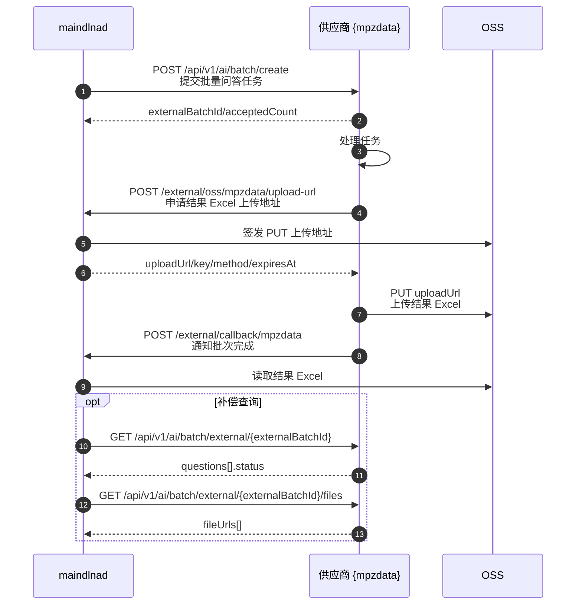

# Mainland 供应商接入文档

## 1. 接入范围

本文档面向下游 AI 数据供应商，说明供应商与mainland 的任务提交、结果上传、完成通知和补偿查询链路。


| 项 | 当前值 | 说明 |
| --- | --- | --- |
| mainland 公网地址 | `https://openapi.mainland.vip` | 供应商回调和申请上传地址使用 |
| 供应商编码 | `mpzdata为例` | mainland提供 |
| 结果模式 | `callback_upload` | 供应商上传结果文件后通知mainland |
| 上传 URL 有效期 | `3600` 秒 | `oss.expire_seconds` |

`X-Provider-Token` 由双方单独提供，不写入本文档。

## 2. 通用约定

### 2.1 鉴权

双方接口均使用请求头 `X-Provider-Token`：

```http
X-Provider-Token: <provider-token>
```

### 2.2 请求格式

```http
Content-Type: application/json; charset=utf-8
```

### 2.3 mainland 响应格式

成功：

```json
{
  "status": 0,
  "message": "",
  "data": {}
}
```

失败：

```json
{
  "status": 401,
  "message": "invalid provider token",
  "data": null
}
```

## 3. 数据链路时序图
系统批量提交问题给供应商
        |
        v
供应商处理并生成 Excel
        |
        v
供应商申请 OSS 上传地址
        |
        v
供应商 PUT 上传 Excel
        |
        v
供应商回调系统通知完成



## 4. mainland 调用供应商：创建批量任务

供应商需提供该接口。

```http
POST https://{供应商域名}/api/v1/ai/batch/create
Content-Type: application/json
X-Provider-Token: <provider-token>
```

### 4.1 请求体

```json
{
  "batchNo": "MAINLAND-20260801-0001",
  "providerCode": "mpzdata",
  "bizDate": "2026-08-01",
  "callbackUrl": "https://openapi.mainland.vip/external/callback/{mpzdata}",
  "items": [
    {
      "itemId": "MAINLAND-20260801-0001-001",
      "platformCode": "doubao",
      "seq": 1,
      "question": "请分析某品牌新能源汽车的目标人群、核心卖点和潜在风险。",
      "deepthink": true,
      "webSearch": true
    }
  ]
}
```

### 4.2 字段说明

| 字段 | 类型 | 必填 | 说明 |
| --- | --- | --- | --- |
| `batchNo` | string | 是 | mainland 生成或接收的批次号，供应商后续上传和回调需原样传回 |
| `providerCode` | string | 是 | 供应商编码，当前为 `mpzdata` |
| `bizDate` | string | 是 | 业务日期，格式 `yyyy-MM-dd` |
| `callbackUrl` | string | 是 | 供应商完成后调用的 mainland回调地址 |
| `items` | array | 是 | 问答任务列表 |
| `items.itemId` | string | 是 | 单条问题唯一 ID，结果文件需原样返回 |
| `items.platformCode` | string | 是 | AI 平台编码 |
| `items.seq` | number | 是 | 问答轮次或期望结果数(例如： 2 说明这个问题需要问2次，同时返回2个qa结果) |
| `items.question` | string | 是 | 问题内容 |
| `items.deepthink` | boolean | 是 | 是否启用深度思考 |
| `items.webSearch` | boolean | 是 | 是否联网搜索 |

### 4.3 `platformCode` 参考值

| 平台名称 | platformCode |
| --- | --- |
| DeepSeek | `deepseek` |
| 通义千问 | `qwen` |
| Kimi | `kimi` |
| 豆包 | `doubao` |
| 腾讯元宝 | `yuanbao` |
| 蚂蚁阿福 | `antafu` |
| 智谱AI | `zhipu` |
| 文心一言 | `yiyan` |

### 4.4 成功响应

```json
{
  "code": 0,
  "message": "success",
  "data": {
    "externalBatchId": "mpzdata-batch-001",
    "acceptedCount": 1
  }
}
```

| 字段 | 类型 | 必填 | 说明 |
| --- | --- | --- | --- |
| `code` | number | 是 | `0` 表示成功，非 `0` 表示失败 |
| `message` | string | 否 | 响应说明 |
| `data.externalBatchId` | string | 是 | 供应商侧批次 ID，后续补偿查询使用 |
| `data.acceptedCount` | number | 否 | 供应商接收数量 |

## 5. 供应商调用 mainland：申请 OSS 上传地址

供应商处理完成后，先调用该接口申请短期有效的 OSS PUT 上传地址。

```http
POST https://openapi.mainland.vip/external/oss/{}/upload-url
Content-Type: application/json
X-Provider-Token: <provider-token>
```

### 5.1 请求体

```json
{
  "batchNo": "MAINLAND-20260801-0001",
  "fileName": "result.xlsx"
}
```

### 5.2 字段说明

| 字段 | 类型 | 必填 | 说明 |
| --- | --- | --- | --- |
| `batchNo` | string | 是 | 创建批量任务时 mainland传入的批次号 |
| `fileName` | string | 否 | 上传文件名；未传时默认 `result.xlsx` |

### 5.3 成功响应

```json
{
  "status": 0,
  "message": "",
  "data": {
    "bucket": "opensource-man",
    "key": "cdp-router/q2a/mpzdata/MAINLAND-20260801-0001/1a2b3c4d-result.xlsx",
    "uploadUrl": "https://opensource-man.oss-cn-shanghai.aliyuncs.com/...",
    "method": "PUT",
    "expiresAt": "2026-08-01T13:30:00+08:00",
    "headers": {}
  }
}
```

### 5.4 上传说明

供应商使用返回的 `uploadUrl` 上传结果 Excel：

```http
PUT <uploadUrl>
```

| 项 | 说明 |
| --- | --- |
| HTTP 方法 | 使用响应中的 `data.method`，当前为 `PUT` |
| 上传地址 | 使用响应中的 `data.uploadUrl` |
| 上传 header | 按 `data.headers` 设置；为空时不要额外设置 |
| 有效期 | 当前为 `3600` 秒 |
| 上传完成后 | 调用 `/external/callback/mpzdata` 通知 mainland |

## 6. 供应商调用 mainland：结果完成通知

供应商上传 Excel 后，调用callback接口配置通知 mainland。

```http
POST https://openapi.mainland.vip/external/callback/{mpzdata}
Content-Type: application/json
X-Provider-Token: <provider-token>
```

### 6.1 请求体

```json
{
  "batchNo": "MAINLAND-20260801-0001",
  "externalBatchId": "mpzdata-batch-001",
  "status": "DONE",
  "totalCount": 1,
  "successCount": 1,
  "failedCount": 0,
  "finishedAt": "2026-08-01T12:30:00+08:00"
}
```

### 6.2 字段说明

| 字段 | 类型 | 必填 | 说明 |
| --- | --- | --- | --- |
| `batchNo` | string | 是 | 创建批量任务时 mainland 传入的批次号 |
| `externalBatchId` | string | 否 | 供应商侧批次 ID |
| `status` | string | 否 | 建议传 `DONE` |
| `totalCount` | number | 否 | 总数 |
| `successCount` | number | 否 | 成功数 |
| `failedCount` | number | 否 | 失败数 |
| `finishedAt` | string | 否 | 完成时间，建议 ISO-8601/RFC3339 |

### 6.3 成功响应

```json
{
  "status": 0,
  "message": "",
  "data": {
    "batchNo": "MAINLAND-20260801-0001",
    "accepted": true
  }
}
```

### 6.4 幂等规则

mainland 按 `batchNo + providerCode` 处理供应商回调：

| 场景 | 处理方式 |
| --- | --- |
|  |
| `batchNo` 不存在 | 返回错误 |
| `X-Provider-Token` 不正确 | 返回 `401` |

## 7. mainland 调用供应商：查询任务状态

该接口用于补偿查询。供应商需要提供。

```http
GET https://{供应商域名}/api/v1/ai/batch/external/{externalBatchId}
X-Provider-Token: <provider-token>
```

`externalBatchId` 为供应商创建批量任务响应中的 `data.externalBatchId`。

### 7.1 成功响应

```json
{
  "success": true,
  "message": "success",
  "code": 200,
  "data": {
    "externalBatchId": "mpzdata-batch-001",
    "questions": [
      {
        "questionId": "MAINLAND-20260801-0001-001",
        "status": 2
      }
    ]
  }
}
```

### 7.2 状态说明

| `questions[].status` | 说明 |
| --- | --- |
| `0` | 待处理 |
| `1` | 处理中 |
| `2` | 处理完成 |

mainland 只有在全部问题 `status=2` 后，才会继续查询供应商结果文件。

## 8. mainland 调用供应商：查询结果文件

该接口用于补偿导入结果。供应商需要提供。

```http
GET https://{供应商域名}/api/v1/ai/batch/external/{externalBatchId}/files
X-Provider-Token: <provider-token>
```

### 8.1 成功响应

```json
{
  "success": true,
  "message": "success",
  "code": 200,
  "data": {
    "externalBatchId": "mpzdata-batch-001",
    "fileUrls": [
      "https://example.com/result.xlsx"
    ]
  }
}
```

### 8.2 说明

| 字段 | 类型 | 说明 |
| --- | --- | --- |
| `data.externalBatchId` | string | 供应商侧批次 ID |
| `data.fileUrls` | array | 结果 Excel 下载地址列表 |

如果供应商主链路已使用 `/external/oss/{mpzdata}/upload-url` 上传 Excel，`fileUrls` 补偿接口仍建议保留，用于异常恢复和人工重入。

## 9. 结果文件要求

| 要求 | 说明 |
| --- | --- |
| 文件格式 | `.xlsx` |
| 原始数据保留 | mainland 会保留原始结果文件 |
| 行标识 | 结果中需能关联回 `itemId` |
| 多轮结果 | 同一 `itemId` 多轮结果需可区分 `seq` |
| 溯源信息 | 如有引用、链接、推荐问题，建议结构化输出 |

当前 mainland 会解析 Excel 结果，抽取回答、思考过程、生成时间、推荐问题、溯源引用等字段，并按 `batchNo + itemId + seq` 幂等保存。

## 10. 联调检查清单

| 检查项 | 要求 |
| --- | --- |
| 供应商 token | 双方配置一致，且只通过 `X-Provider-Token` 传递 |
| 创建任务响应 | `code=0` 且返回 `data.externalBatchId` |
| `batchNo` | 上传地址申请和完成通知需原样传回 |
| 上传流程 | 先申请 `uploadUrl`，再 `PUT` Excel，最后完成通知 |
| 完成通知 | 成功时 mainland 返回 `data.accepted=true` |
| 补偿查询 | 状态接口和文件接口可按供应商批次 ID 查询 |
| 敏感信息 | token、签名 URL 不写入日志和文档 |
