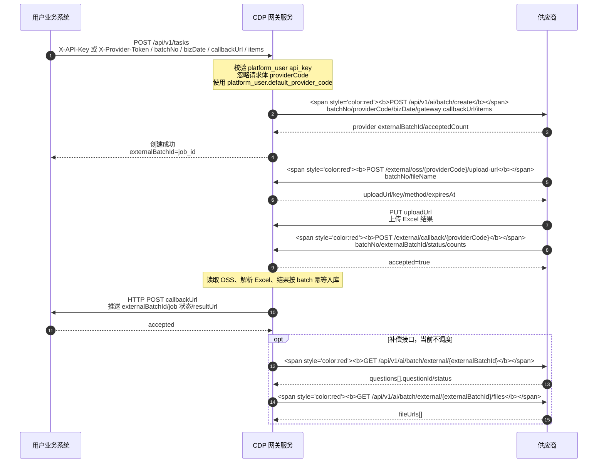

# CDP Router 网关服务技术方案

## 1. 建设目标

CDP Router 是一个 Go 业务网关服务，第一阶段作为 CDP/AI 任务业务代理，对上提供稳定、高并发、可观测的 HTTP API，对下屏蔽供应商或下游 CDP 服务差异。

核心能力：

- 任务记录：记录任务创建、提交、轮询、回调、导入、清洗、失败重试的完整生命周期。
- 结果接入：第一版以供应商上传 OSS + 完成通知为主链路，网关负责签发公网 OSS 上传地址、导入结果、回调业务方。
- 补偿查询：保留对下游任务状态和结果文件的查询能力，当前不启动定时轮询调度。
- 数据清洗：解析下游 Excel/JSON 结果，做字段标准化、去重、校验、映射、聚合和异常行隔离。
- 高并发代理：提供限流、熔断、超时、重试、连接池、幂等和降级能力，支撑大量并发 API 请求。
- 可扩展接入：通过 provider adapter 适配不同 CDP、Q2A、AI 平台或数据供应商。

## 2. 参考架构约定

参考 `/Users/Mark/Desktop/milun/xinyangzc/xinyangzc-api/docs/architecture.md`，保留以下工程约定：

```text
cmd/<service>/main.go       进程启动和依赖装配
configs/                    运行配置示例
docs/                       架构、接口、运维文档
api/<module>/v1/*.proto     API 协议事实来源
internal/config/            配置、默认值、校验
internal/httpapi/           Gin HTTP Server、路由、中间件、统一响应
internal/service/           HTTP handler 协议转换和 usecase 调用
internal/biz/               业务用例、实体、仓储接口
internal/data/              DB/Redis/OSS/外部服务仓储实现
internal/pkg/               通用基础库
scripts/check.sh            本地统一校验入口
Dockerfile                  多阶段构建镜像
```

整体调用链路：

```text
HTTP Client
  -> internal/httpapi
  -> internal/service
  -> internal/biz
  -> internal/data
  -> downstream provider / database / object storage
```

当前阶段不引入 gRPC 对接方式。protobuf 只作为对外结构、枚举、错误码和接口契约的统一维护入口，Gin 负责真实 HTTP 请求处理，OpenAPI 由 proto 自动生成。

## 3. 推荐技术栈

- 语言：Go 1.22+。
- HTTP Server：Gin，对外提供 HTTP/JSON。
- API 契约：Protocol Buffers 维护 request/response/message/enum/service 定义。
- OpenAPI：通过 proto annotations 自动生成 OpenAPI 3 文档，随构建产物或 `/api/openapi.json` 暴露。
- Admin Web：Vite + React + TypeScript 构建 SPA，由 Go 服务通过 `/admin/*` 内置托管。
- 数据库：PostgreSQL 15+，当前数据库名为 `cdp-admin`。
- DB 访问：`sqlc` 或 `sqlx`。任务状态机和事务边界明确，优先 `sqlc` 获取类型安全 SQL。
- 缓存/队列协同：Redis，用于分布式锁、限流、幂等短缓存、轮询调度游标。
- 异步任务：第一阶段使用 worker goroutine + Postgres lease；任务量上来后再评估 Kafka/RabbitMQ。
- 文件存储：OSS/S3 兼容对象存储，保存下游原始文件、清洗后文件和错误行报告。
- Excel 解析：`excelize`。
- 配置：JSON 或 YAML，保持参考项目的 configfile + Validate 模式。
- 日志：`log/slog`，JSON 格式，字段包含 `request_id`、`task_id`、`provider_code`、`batch_no`。
- 指标：Prometheus + OpenTelemetry，覆盖 API 延迟、下游耗时、轮询频率、任务状态分布、清洗失败率。

## 4. 项目目录结构

```text
cdp-router/                  仓库根目录
  AGENTS.md
  docs/
    gateway-architecture.md
    current-handoff.md
    AI数据接入文档/
      AI数据来源接口.md
      api.md
  web/
    admin/                   Admin Web 源码，与 Go 服务目录同级
      package.json
      vite.config.ts
      index.html
      src/
        main.tsx
        App.tsx
        pages/
        components/
        layouts/
        api/
        types/
        styles/
  cdp-router/                Go 服务项目目录
    api/
      task/v1/
        task.proto
        task.pb.go
      provider/v1/
        provider.proto
        provider.pb.go
      admin/v1/
        admin.proto
        admin.pb.go
    openapi/
      openapi.yaml
    web/
      admin/
        dist/                 Admin Web 构建产物，镜像打包使用，不作为源码目录
    cmd/
      cdp-router/
        main.go
    configs/
      cdp-router.conf
    internal/
      config/
        config.go
      httpapi/
        server.go
        middleware.go
        error.go
        router.go
        openapi.go
        admin_static.go
      service/
        task_service.go
        result_service.go
        admin_service.go
      biz/
        task.go
        task_usecase.go
        polling_usecase.go
        cleaning_usecase.go
        proxy_usecase.go
        provider.go
        errors.go
      data/
        db.go
        tx.go
        task_repo.go
        provider_repo.go
        result_repo.go
        oss_store.go
        downstream_client.go
      worker/
        scheduler.go
        poller.go
        submitter.go
        cleaner.go
        retry.go
      provider/
        adapter.go
        batch_provider_adapter.go
        registry.go
      cleaner/
        excel_reader.go
        normalize.go
        dedupe.go
        validate.go
        aggregate.go
      proxy/
        reverse_proxy.go
        transport.go
        limiter.go
        circuit_breaker.go
      pkg/
        configfile/
        logger/
        idgen/
        clock/
        httputil/
        retry/
        semaphore/
    migrations/
      000001_init.sql
    scripts/
      check.sh
    Makefile
    Dockerfile
    go.mod
```

## 5. API 契约和 OpenAPI 生成

### 5.1 proto 使用方式

当前阶段不生成、不注册 gRPC server，也不使用 grpc-gateway 运行时。proto 的职责是统一维护：

- 对外 request/response 结构。
- 枚举，例如任务状态、任务阶段、供应商状态。
- 错误码和统一响应结构。
- HTTP 方法、路径、请求体和响应体契约。
- OpenAPI 生成所需的接口说明。

建议 proto 仍保留 `service` 定义，并通过 `google.api.http` 标注 HTTP 路由：

```proto
service TaskAPI {
  rpc CreateTask(CreateTaskRequest) returns (CreateTaskResponse) {
    option (google.api.http) = {
      post: "/api/v1/tasks"
      body: "*"
    };
  }

  rpc GetTask(GetTaskRequest) returns (GetTaskResponse) {
    option (google.api.http) = {
      get: "/api/v1/tasks/{id}"
    };
  }
}
```

这里的 `service` 是 API 契约，不代表服务进程必须开放 gRPC 端口。Gin handler 手写注册路由，但必须与 proto annotation 保持一致。

### 5.2 Gin 与 protobuf JSON

Gin handler 不直接使用 `encoding/json` 输出 protobuf message，统一使用 `protojson`，保证 JSON 字段命名、枚举、默认值和 OpenAPI 契约一致。

推荐封装：

```go
func BindProtoJSON(c *gin.Context, msg proto.Message) error {
    body, err := io.ReadAll(c.Request.Body)
    if err != nil {
        return err
    }
    return protojson.UnmarshalOptions{
        DiscardUnknown: false,
    }.Unmarshal(body, msg)
}

func ProtoJSON(c *gin.Context, status int, msg proto.Message) {
    body, err := protojson.MarshalOptions{
        UseProtoNames:   false,
        EmitUnpopulated: true,
    }.Marshal(msg)
    if err != nil {
        c.Status(http.StatusInternalServerError)
        return
    }
    c.Data(status, "application/json; charset=utf-8", body)
}
```

Gin 的职责：

- 路由注册。
- 请求上下文、鉴权、限流、日志、recover、CORS。
- 调用 `service` 层。
- 统一错误响应。

`service` 层职责：

- 将 Gin 请求绑定到 protobuf request。
- 调用 biz usecase。
- 将 biz entity 转换成 protobuf response。
- 将业务错误转换成统一错误结构和 HTTP status。

### 5.3 OpenAPI 自动生成

推荐使用 `buf` 或 Makefile 统一生成：

```text
api/**/*.proto
  -> protoc-gen-go
  -> *.pb.go
  -> protoc-gen-openapi 或 protoc-gen-openapiv2
  -> openapi/cdp-router.openapi.json
```

OpenAPI 生成策略：

- 如果要求 OpenAPI 3，使用支持 OpenAPI 3 的 proto openapi 插件生成 `openapi/cdp-router.openapi.json`。
- 如果现有工具链更偏向 grpc-gateway，可只使用 `protoc-gen-openapiv2` 生成 Swagger v2，再由构建脚本转换为 OpenAPI 3；服务运行时仍不引入 grpc-gateway。
- 生成产物通过 `/api/openapi.json` 暴露，并可通过 `/api/docs` 挂载 Swagger UI 或 Scalar UI。

Makefile 建议：

```makefile
.PHONY: proto openapi

proto:
	protoc -I api -I third_party \
	  --go_out=. --go_opt=paths=source_relative \
	  $$(find api -name '*.proto')

openapi:
	protoc -I api -I third_party \
	  --openapi_out=openapi \
	  $$(find api -name '*.proto')
```

`scripts/check.sh` 是日常代码变更的默认检查入口，不执行任务 E2E；任务 E2E 需要显式运行 `make e2e-test`。默认检查至少执行：

- 非 E2E Go 包测试，例如排除 `./tests/e2e` 后的 `go test`
- `make proto`
- `make openapi`
- 检查生成文件是否有未提交差异。

### 5.4 proto 与 Gin 路由一致性

为了避免手写 Gin 路由和 proto annotation 漂移，建议增加一个路由契约测试：

- 从生成的 OpenAPI JSON 读取 path/method。
- 从 Gin engine 的 `Routes()` 读取实际 path/method。
- 对外 API 必须双向匹配。
- `/health`、`/ready`、`/metrics` 等基础运维接口可以放入白名单。

## 6. 领域模型

### Task

业务任务，来自用户业务系统。例如 AI 问答批次任务。

关键字段：

- `id`：内部任务 ID。
- `external_batch_id`：供应商批次 ID，由 `POST /api/v1/ai/batch/create` 返回。
- `provider_code`：下游供应商或平台编码。
- `batch_no`：业务批次号，作为任务幂等键和业务方查询/回调关联键。
- `status`：`CREATED`、`SUBMITTED`、`POLLING`、`PROVIDER_DONE`、`IMPORTING`、`CLEANING`、`CALLBACK_PENDING`、`DONE`、`FAILED`、`CANCELED`。
- `stage`：`submit`、`polling`、`result_fetching`、`import`、`cleaning`、`callback`。
- `progress`、`completed_count`、`total_count`。任务总量按系统实际生成并下发给供应商的任务明细统计，不直接从 `raw_request` 或接入方原始 `items[].seq` 推导。
- `raw_request`、`raw_response`：保留必要原始输入输出，方便审计和排障。
- `next_poll_at`、`last_poll_at`、`poll_count`、`last_error`。
- `locked_by`、`locked_until`：任务级 Postgres lease，用于多实例并发安全。

### TaskItem

任务问题明细，对应业务方提交的 `items[]`，并承载供应商状态查询返回的问题状态。该表只保存任务项身份、问题内容、供应商问题状态和结果导入状态，不保存大段 AI 回答和引用结果。

关键字段：

- `task_id`
- `batch_no`
- `item_id`：业务方提交的单条问题唯一标识。
- `question_id`：供应商状态查询返回的问题 ID。
- `platform_code`
- `seq`：业务方提交的上游轮次/顺序标记，保留用于审计和排障；`seq=2` 只表示第二个轮次或位置，不表示该 item 需要执行两次，也不作为网关侧任务数量扩容依据。
- `question`
- `deepthink`
- `web_search`
- `status`：供应商问题状态，`0` 待处理、`1` 处理中、`2` 处理完成。
- `result_status`：结果导入状态，`PENDING`、`IMPORTED`、`PARSE_FAILED`。
- `result_imported_at`
- `raw_item`

真实接口测试观察：

- `GET /api/v1/ai/batch/external/{externalBatchId}` 返回 `data.questions[]`。
- 当前测试返回的 `questionId` 与提交的 `itemId` 一致，例如 `Q2A2-realflow-20260722100837-001`。
- 数据结构仍保留 `question_id` 独立字段，不强依赖它永远等于 `item_id`。
- 更新问题状态时优先按 `task_id + item_id` 匹配；如果后续供应商返回不同的 `questionId`，再按 `question_id` 建索引和匹配策略。

### 6.1 任务总数口径

任务总数只有一个权威口径：任务创建时实际落库到 `cdp_task_items` 的 item 数。

- 上游业务方提交任务后，网关先生成并落库任务明细；`cdp_tasks.total_count` 必须等于当前任务的 `cdp_task_items` 数。
- 下发给供应商的任务明细数量必须等于该总数；供应商提交响应中的 `acceptedCount` 如果非 0，必须等于该总数，否则提交失败并记录 `PROVIDER_SUBMIT_FAILED`。
- 供应商 `status_url` 或完成 callback 返回的 `totalCount / successCount / failedCount` 只用于和本地任务总数做校验，不允许反向覆盖本地任务总数。
- 结果导入后的 `success_count / failed_count` 按 item 维度统计：一个 item 只要存在至少一条 `parse_status='SUCCESS'` 的结果，就计为成功；没有成功但存在失败结果时计为失败。
- `cdp_task_item_results` 可以按 `seq` 保存同一 item 的多轮结果；该 `seq` 是结果轮次编号，不表示“需要执行几次”，多轮结果不能扩大任务总数。
- 回调 readiness、后台手动回调提示、最终业务方 callback payload 的 `counts.total` 都必须使用本地任务总数。

### Provider

下游服务配置和能力声明。第一版不做 provider 数据库维护和后台管理 API，通过配置文件 `[providers.<code>]` 简单维护，服务启动时一次性加载到内存并常驻；配置变更后重启服务生效。

新增 provider 的完整接入步骤见 `docs/provider-onboarding.md`。实现原则：

- 通用协议一致时只增加配置，不新增代码。
- 完成文件处理有差异时，在 `internal/provider/<provider_code>_provider.go` 中实现 provider 自己的 `fileCompletion`。
- 提交、状态、文件列表、下载协议有差异时，新增独立 provider adapter 实现 `biz.ProviderClient`。
- 不允许在 biz/service/httpapi 层硬编码 provider code。

- `provider_code`
- `display_name`
- `token`：用于 `X-Provider-Token` 校验，也是网关调用供应商接口时的优先鉴权头。
- `api_key`：用于 `X-API-Key` 鉴权；当 `token` 为空且 `api_key` 非空时，网关调用供应商接口使用该字段。
- `bucket_path_prefix`：该 provider 的 OSS object key 前缀。
- `submit_url`
- `status_url`
- `files_url`
- `timeout_seconds`

### Result

任务结果和清洗产物。结果必须保存到数据库，不能只保存文件 URL。

任务相关表不使用数据库 foreign key 约束；通过 `task_id`、`task_item_id`、`result_file_id` 等业务关联字段和索引维护查询关系，避免清表、重入和运维修复被外键约束阻断。

关键字段：

- `task_id`
- `batch_no`
- `external_batch_id`
- `file_url`
- `file_name`
- `row_count`
- `valid_row_count`
- `invalid_row_count`
- `checksum`
- `schema_version`

### TaskItemResult

每个问答轮次的稳定平铺结果，后台页面和业务最终结果展示优先读取该表。供应商 Excel 中 `AI回答` sheet 的一行对应 0 或 1 条 `TaskItemResult`；同一 `itemId` 多次出现时不能去重丢弃，而是按出现顺序生成结果轮次 `seq=1,2,...` 并分别保存。`溯源信息` sheet 的多行引用按 `itemId + seq` 聚合到对应结果的 `references_json`；如果溯源 sheet 没有轮次字段，则作为兼容数据复用到该 `itemId` 的各轮结果。

关键字段：

- `task_id`
- `task_item_id`
- `batch_no`
- `item_id`
- `seq`：结果轮次编号，来自 Excel `AI回答` 同一 `itemId` 的出现顺序，或结果文件显式轮次字段。
- `platform_code`
- `question`
- `answer_text`
- `thinking_process`
- `generated_at`
- `generated_at_text`
- `recommended_questions`
- `device_id`
- `recording_url`
- `references_json`
- `cleaned_payload`
- `parse_status`
- `parse_error`
- `result_file_id`
- `answer_sheet_row_index`
- `reference_count`
- `row_hash`

### ResultRow

供应商结果文件解析后的原始结构化行数据。该表用于审计、排障和重新解析，不作为最终业务展示表。结果行保留 `seq` 便于追溯某一行属于第几轮回答；非问答行或无轮次信息时可为 0。

关键字段：

- `task_id`
- `batch_no`
- `external_batch_id`
- `result_file_id`
- `sheet_name`
- `row_index`
- `item_id`
- `seq`
- `row_data`
- `row_hash`
- `parse_error`

## 7. 数据库设计草案

数据库使用 PostgreSQL，数据库名为 `cdp-admin`。结果数据必须按 batch 幂等入库。当前按无历史数据处理，第一版不保留补偿获取 attempts 表。

```sql
create table cdp_tasks (
  id bigserial primary key,
  batch_no varchar(128) not null,
  provider_code varchar(64) not null,
  gateway_code varchar(64),
  external_batch_id varchar(128),
  biz_date date,
  status varchar(32) not null,
  stage varchar(32),
  callback_url text,
  raw_request jsonb not null,
  provider_request jsonb,
  provider_response jsonb,
  total_count int not null default 0,
  completed_count int not null default 0,
  success_count int not null default 0,
  failed_count int not null default 0,
  progress int not null default 0,
  poll_count int not null default 0,
  next_poll_at timestamptz,
  last_poll_at timestamptz,
  locked_by varchar(128),
  locked_until timestamptz,
  last_error text,
  submitted_at timestamptz,
  provider_finished_at timestamptz,
  result_imported_at timestamptz,
  callback_sent_at timestamptz,
  created_at timestamptz not null default now(),
  updated_at timestamptz not null default now(),
  unique (batch_no)
);

create index idx_cdp_tasks_poll
  on cdp_tasks(status, next_poll_at, locked_until);

create table cdp_task_items (
  id bigserial primary key,
  task_id bigint not null,
  batch_no varchar(128) not null,
  item_id varchar(128) not null,
  question_id varchar(128),
  platform_code varchar(64) not null,
  seq int not null,
  question text not null,
  deepthink boolean not null default false,
  web_search boolean not null default false,
  status int not null default 0,
  result_status varchar(32) not null default 'PENDING',
  result_imported_at timestamptz,
  raw_item jsonb not null,
  created_at timestamptz not null default now(),
  updated_at timestamptz not null default now(),
  unique (task_id, item_id)
);

create index idx_cdp_task_items_question_id
  on cdp_task_items(task_id, question_id);

create index idx_cdp_task_items_detail_priority
  on cdp_task_items(
    task_id,
    (
      case
        when result_status in ('FAILED','PARSE_FAILED','ERROR') then 0
        when result_status <> 'IMPORTED' or status <> 2 then 1
        else 2
      end
    ),
    seq,
    id
  );

create table cdp_task_events (
  id bigserial primary key,
  task_id bigint not null,
  event_type varchar(64) not null,
  payload jsonb,
  created_at timestamptz not null default now()
);

create index idx_cdp_task_events_task_id
  on cdp_task_events(task_id, created_at);

create table cdp_task_result_files (
  id bigserial primary key,
  task_id bigint not null,
  batch_no varchar(128) not null,
  external_batch_id varchar(128) not null,
  source_type varchar(32) not null,
  object_key text,
  file_url text,
  file_name varchar(255),
  checksum varchar(128),
  parse_status varchar(32) not null,
  row_count int not null default 0,
  valid_row_count int not null default 0,
  invalid_row_count int not null default 0,
  last_error text,
  fetched_at timestamptz,
  parsed_at timestamptz,
  created_at timestamptz not null default now(),
  updated_at timestamptz not null default now(),
);

create unique index idx_cdp_task_result_files_object_key
  on cdp_task_result_files(batch_no, object_key)
  where object_key is not null;

create unique index idx_cdp_task_result_files_file_url
  on cdp_task_result_files(batch_no, file_url)
  where file_url is not null;

-- 供应商 files 接口在任务未完成或暂无文件时返回 fileUrls=[]，
-- 此时不创建 cdp_task_result_files 记录，只记录日志或任务事件。

create table cdp_task_item_results (
  id bigserial primary key,
  task_id bigint not null,
  task_item_id bigint not null,
  batch_no varchar(128) not null,
  item_id varchar(128) not null,
  platform_code varchar(64),
  question text,
  answer_text text,
  thinking_process text,
  generated_at timestamptz,
  generated_at_text varchar(64),
  recommended_questions jsonb not null default '[]'::jsonb,
  device_id varchar(128),
  recording_url text,
  references_json jsonb not null default '[]'::jsonb,
  cleaned_payload jsonb not null,
  parse_status varchar(32) not null default 'SUCCESS',
  parse_error text,
  result_file_id bigint not null,
  seq int not null default 1,
  answer_sheet_row_index int,
  reference_count int not null default 0,
  row_hash varchar(128),
  created_at timestamptz not null default now(),
  updated_at timestamptz not null default now()
);

create unique index idx_cdp_task_item_results_task_item_seq
  on cdp_task_item_results(task_item_id, seq);

create index idx_cdp_task_item_results_task_id_seq
  on cdp_task_item_results(task_id, item_id, seq);

create index idx_cdp_task_item_results_batch_no_seq
  on cdp_task_item_results(batch_no, item_id, seq);

create table cdp_task_result_rows (
  id bigserial primary key,
  task_id bigint not null,
  batch_no varchar(128) not null,
  external_batch_id varchar(128) not null,
  result_file_id bigint not null,
  sheet_name varchar(128) not null,
  row_index int not null,
  item_id varchar(128),
  seq int not null default 0,
  row_data jsonb not null,
  row_hash varchar(128),
  parse_error text,
  created_at timestamptz not null default now(),
  updated_at timestamptz not null default now(),
  unique (result_file_id, sheet_name, row_index)
);

create table cdp_task_callbacks (
  id bigserial primary key,
  task_id bigint not null,
  target_url text not null,
  request_payload jsonb,
  response_status int,
  response_body text,
  status varchar(32) not null,
  retry_count int not null default 0,
  last_error text,
  created_at timestamptz not null default now(),
  updated_at timestamptz not null default now()
);
```

## 8. 核心流程

### 8.0.1 接入方 API Key 与对外任务 ID

网关在供应商 `provider` 之外增加接入方配置 `platform_users`。`provider` 表示网关对下游供应商的配置，`platform_users` 表示调用网关的业务接入方配置。

第一版 `api_key` 按明文保存和查询，不做哈希、不做前后缀展示处理；但日志仍不得打印完整 `api_key`。

```sql
create table platform_users (
  id bigserial primary key,
  platform_code varchar(64) not null,
  name varchar(128) not null,
  api_key varchar(256) not null,
  status varchar(32) not null default 'ACTIVE',
  default_provider_code varchar(64) not null,
  callback_mode varchar(64) not null default 'DEFAULT_HTTP',
  callback_url text,
  callback_config jsonb not null default '{}'::jsonb,
  created_at timestamptz not null default now(),
  updated_at timestamptz not null default now()
);

create unique index idx_platform_users_platform_code
  on platform_users(platform_code);

create unique index idx_platform_users_api_key
  on platform_users(api_key);
```

`cdp_tasks` 增加接入方归属和网关对外任务 ID：

```sql
alter table cdp_tasks add column job_id varchar(64);
alter table cdp_tasks add column platform_user_id bigint;
alter table cdp_tasks add column platform_code varchar(64);
alter table cdp_tasks add column provider_external_batch_id varchar(128);

create unique index idx_cdp_tasks_job_id
  on cdp_tasks(job_id);

create index idx_cdp_tasks_platform_user_created_at
  on cdp_tasks(platform_user_id, created_at);

create index idx_cdp_tasks_provider_external_batch_id
  on cdp_tasks(provider_external_batch_id)
  where provider_external_batch_id is not null;
```

字段语义：

| 字段 | 面向对象 | 说明 |
| --- | --- | --- |
| `job_id` | 接入方/网关 | 网关生成的对外任务 ID，对 API 返回时字段名为 `externalBatchId` |
| `provider_external_batch_id` | 网关/供应商 | 供应商创建任务后返回的 `externalBatchId` |
| `platform_user_id` | 网关内部 | 标记本任务由哪个接入方 API key 发起 |
| `platform_code` | 网关内部/后台 | 接入方唯一编码，来自 `platform_users.platform_code` |

接入方调用网关统一使用：

```http
X-API-Key: <platform_user.api_key>
```

为兼容历史调用方，任务创建和接入方查询接口也接受：

```http
X-Provider-Token: <platform_user.api_key>
```

两种 header 都表示接入方 `platform_users.api_key`；如果两个 header 同时存在，优先使用 `X-Provider-Token`。该兼容不改变供应商回调/上传接口的鉴权语义，`/external/*` 仍使用 provider 配置中的 token。

网关按明文 `api_key` 查询 `platform_users`，校验 `status=ACTIVE` 后写入任务归属。任务查询接口必须按 `platform_user_id + job_id` 校验归属，禁止跨接入方读取。

### 8.0 服务级时序图

本项目第一版流程只涉及 3 个服务角色：用户业务系统、CDP 网关服务、供应商。网关内部数据库、worker、OSS client 等实现细节不在该图中展开。

图中红色节点为供应商文档中定义的接口调用点。第一版以 OSS 上传和完成通知为主链路；状态/结果查询只作为补偿接口保留，当前不做定时调度。



说明：

- 用户业务系统提交任务时，必须带 `X-API-Key` 或兼容 header `X-Provider-Token`；header 值均为 `platform_users.api_key`。请求体 `providerCode` 仅保留协议兼容，不参与供应商选择，网关始终使用 `platform_users.default_provider_code`。
- 请求体 `callbackUrl` 只影响网关处理完成后回调接入方的地址，可覆盖 `platform_users.callback_url`。它不会作为供应商回调网关的地址下发；阳狮定制回调未传 `callbackUrl` 时，fallback 到 `platform_users.<code>.callback_config` 中的 `baseURL + /external/callback/{providerCode}`。
- 网关创建 `job_id`，对接入方统一返回为 `externalBatchId`；创建任务响应不返回内部 `taskId`。
- 网关提交给供应商时，使用供应商文档中的 `POST /api/v1/ai/batch/create`；请求里的 `callbackUrl` 由 `server.public_base_url + /external/callback/{providerCode}` 生成，线上为 `https://openapi.mainland.vip/external/callback/{providerCode}`。保存返回的 `externalBatchId` 到 `provider_external_batch_id`。
- 系统内部统一约定：`seq` 只代表轮次/位置，不代表要执行几次；任务总数只看 `cdp_task_items` 的 item 数。mpzdata 供应商接口中的 `items[].seq` 语义不同，它表示单条问题的执行次数。网关提交给 mpzdata 且业务只要求执行一次时，供应商请求里的 `seq` 必须改写为 `1`，不得直接透传接入方原始 `seq`。当前阳狮来源接入方（`platform_code=yangshi` 或 `yangshi_*`）走该兼容改写；其他接入方不做改写。
- 面向特定接入方的请求兼容改写统一放在 `internal/biz/customer_adapter.go`，由提交链路在调用 provider adapter 前执行。后续其他客户有字段语义、默认值或兼容格式差异时，在 customer adapter 中增加规则，不把客户特判散落到 service、usecase 主流程或 provider adapter。
- 供应商任务创建成功后，网关才向业务方返回任务创建成功；供应商创建失败时任务标记 `FAILED` 并返回失败。
- 供应商完成后先申请 OSS 上传地址，上传 Excel 后再调用完成通知。
- 网关读取 OSS 文件并保存结构化结果后，再按业务端提交时的 `callbackUrl` 或接入方默认回调地址推送最终状态和结果 URL。
- 补偿查询接口可手动查询供应商状态和结果文件，但当前不启动定时轮询。

### 8.1 创建任务

```text
Client
  -> POST /api/v1/tasks
  -> service 通过 X-API-Key 或 X-Provider-Token 识别 platform_user
  -> service 忽略请求体 providerCode，使用 platform_user.default_provider_code
  -> biz 生成 job_id
  -> data 在事务内写 platform_user_id + cdp_tasks + cdp_task_items + cdp_task_events
  -> biz 同步调用 provider submit_url
  -> provider 创建成功后更新 provider_external_batch_id / SUBMITTED
  -> 返回 externalBatchId=job_id
```

设计要点：

- 上游可传 `Idempotency-Key`，没有则按业务请求摘要生成。
- 创建接口必须同步完成供应商任务创建；供应商创建失败时，对接入方返回失败。
- 供应商创建失败的任务仍保留数据库记录，状态为 `FAILED`，用于排障。
- 创建成功响应只返回 `externalBatchId=job_id`、`batchNo` 和 `accepted`，不返回内部 `taskId`。

### 8.2 提交下游

当前任务创建接口必须同步完成供应商任务创建，只有供应商下发成功后才向接入方返回创建成功。worker 不自动扫描 `CREATED` 任务执行 `SubmitPending`，避免和创建接口同步下发形成重复提交。

针对当前供应商任务下发接口，由 provider adapter 调用：

- `POST /api/v1/ai/batch/create`
- Header: `X-Provider-Token`
- 保存返回的 `data.externalBatchId` 到 `provider_external_batch_id`

### 8.3 OSS 上传和完成通知主链路

```text
Provider
  -> POST /external/oss/{providerCode}/upload-url
  -> 网关校验 X-Provider-Token
  -> 网关按 batchNo 找到任务
  -> 签发 OSS PUT URL
  -> 保存 result_object_key/result_file_name
  -> 返回 bucket/key/uploadUrl/method/expiresAt/headers
Provider
  -> PUT uploadUrl 上传 Excel
  -> POST /external/callback/{providerCode}
Gateway
  -> 标记 PROVIDER_DONE
  -> worker 读取 OSS object
  -> 解析、清洗、幂等保存结果
  -> 确认所有 cdp_task_items.result_status='IMPORTED' 且 success_count + failed_count = total_count
  -> 标记 CALLBACK_PENDING
  -> callback worker 通知业务方
```

OSS 签名约束：

- 当前 bucket 为 `opensource-man`。
- 供应商可访问的公网域名为 `https://opensource-man.oss-cn-shanghai.aliyuncs.com`。
- 不使用 CNAME。
- 不返回 `oss-cn-shanghai-internal.aliyuncs.com` 等内网 endpoint。
- 供应商上传的任务结果文件不是临时文件，不设置 7 天删除 tag；后台导出下载生成的临时 Excel 文件才写入 OSS 临时目录，并打 `cdp-temp=true`、`expire-days=7` tag。

### 8.4 回调扩展方式

默认 `DEFAULT_HTTP` 回调：网关向任务 `callback_url` 发送 `externalBatchId`、`batchNo`、`status`、`counts` 和 `resultUrl`。

接入方编码或回调模式匹配 `yangshi` 关键词时，统一使用阳狮/Wiredcraft 定制回调链路，配置项放在各自接入方的 `callback_config` 中。网关按结果 Excel 通知阳狮/Wiredcraft：先申请对方 OSS 上传地址，再 PUT 上传 Excel，最后调用完成通知接口。

业务方回调必须满足以下门槛后才允许触发：

- 供应商完成确认已成功入库，任务已进入 `PROVIDER_DONE`。完成确认可以来自供应商 `/external/callback/{providerCode}`，也可以来自主动检查 `status_url` 返回的标准数量校验结果。
- 所有结果文件导入流程已经结束，不允许单个文件导入成功后提前置为 `CALLBACK_PENDING`。
- 所有 `cdp_task_items.result_status='IMPORTED'`。
- 任务汇总满足 `success_count + failed_count = total_count`。

后台手动回调必须先做同一套数量校验：

- 已经回调成功的 `DONE` 任务、以及业务回调失败后进入 `FAILED` 的任务，都允许后台发起重复回调。
- 数量一致时，直接重新回调业务方。
- 数量不一致时，不自动回调，接口返回当前 `success_count / total_count`、校验原因和 `forceRequired=true`，后台页面展示二次确认。
- 运维二次确认强制回调时，只使用当前已成功导入的结果内容生成回调 payload 或定制 Excel，不把未导入、空回答或失败项混入强制回调结果。

如果同一个任务存在多份结果文件，定制回调必须先合并成一份 Excel 再上传给阳狮/Wiredcraft：

- 同名 sheet 追加合并。
- 表头只保留第一份文件的第一行。
- 合并文件名使用 `<batchNo>-result.xlsx`。
- 原始文件仍按 batch 保留在 `cdp_task_result_files`，用于排障、重入和后台展示。

单文件或合并前的原始文件来源优先级为：

1. `cdp_tasks.result_object_key` 指向的本项目 OSS 原始文件。
2. `cdp_task_result_files.object_key` 指向的本项目 OSS 原始文件。
3. `cdp_task_result_files.file_url`。若判断为本项目 OSS 域名则转 OSS object 读取，否则用 HTTP 下载外部文件。

阳狮定制配置示例：

```json
{
  "baseURL": "https://staging-api-growth.wiredcraft.cn/api2",
  "providerCode": "vendor_a",
  "providerToken": "vendor-provider-token"
}
```

`baseURL` 和 `providerCode` 必须从 conf 读取；`providerToken` 为空时回退使用该 `platform_user.api_key`。

代码目录保留标准定制接入方式：

```text
internal/callback/
  adapter.go          回调 adapter 接口和 registry
  http_callback.go    DEFAULT_HTTP 实现
  yangshi_callback.go 阳狮/Wiredcraft 定制上传文件 + 完成通知实现；多文件先合并为单份 Excel
```

后续接入其他定制网关时，新增独立 adapter，实现统一接口并按 `platform_users.callback_mode` 与 `platform_code` 选择即可。定制 adapter 只负责目标网关的 header、鉴权、字段映射和响应错误映射，不应把定制 payload 拼接逻辑散落到 biz 或 service 层。

后台支持对单个任务重试回调：

```http
POST /api/admin/v1/tasks/{id}/retry-callback
```

该接口只重试指定任务，重新生成当前任务状态和 `resultUrl` payload，并写入 `cdp_task_callbacks` 与后台审计日志。

### 8.5 补偿查询接口

当前不启动定时轮询调度，只保留手动补偿能力：

当前供应商查询接口：

- `GET /api/v1/ai/batch/external/{externalBatchId}`：查询问题状态，状态 `0` 待处理、`1` 处理中、`2` 处理完成。
- `GET /api/v1/ai/batch/external/{externalBatchId}/files`：查询处理结果文件地址列表。
- 两个接口均使用 Header `X-Provider-Token` 鉴权。

状态判断说明：

- `questions[].status=1` 只表示该问题仍在处理中，不表示批次完成，也不表示结果文件已经生成。
- 供应商完成确认的标准来源有两个：供应商完成 callback，或 `status_url` 返回 `successCount + failedCount = 本地任务 item 数` 且 `totalCount` 为空或等于本地任务 item 数。
- `questions[].status` 用于保存问题级进度和兼容判断是否可以尝试拉取结果文件；仅 `questions[].status` 全部为 `2` 不会生成 providerCallback，也不会把任务推进为 `PROVIDER_DONE`。
- 如果任一问题仍为 `0` 或 `1`，`sync-provider-result` 只更新本地问题状态，不查询、不导入结果文件；此时供应商 `files_url` 返回 `fileUrls=[]` 属于预期。
- 如果所有问题都为 `2` 但 `fileUrls=[]`，表示供应商已完成状态和文件生成之间存在延迟，或供应商 files 接口尚未写入文件记录；可稍后重试 `sync-provider-result`。
- 网关对外统一在补偿查询响应 `data.msg` 和顶层 `message` 返回供应商说明文案。`mpzdata` 会返回“已处理 x/y，结果文件已/未生成”的进度说明；后续其他 provider 可以按 adapter/provider code 扩展自己的文案。

真实测试返回示例：

```json
{
  "success": true,
  "message": "查询成功",
  "data": {
    "externalBatchId": "bb3158f840d045bd93dfdb50e3d37d02",
    "questions": [
      {
        "questionId": "Q2A2-realflow-20260722100837-001",
        "status": 0
      },
      {
        "questionId": "Q2A2-realflow-20260722100837-002",
        "status": 0
      }
    ]
  },
  "code": 200
}
```

结果文件接口在任务未完成时返回：

```json
{
  "success": true,
  "message": "查询成功",
  "data": {
    "externalBatchId": "bb3158f840d045bd93dfdb50e3d37d02",
    "fileUrls": []
  },
  "code": 200
}
```

当供应商返回如下处理中状态时：

```json
{
  "status": 0,
  "message": "",
  "data": {
    "externalBatchId": "b1642d69ddad4afeaa629a2ce57c2348",
    "questions": [
      {
        "questionId": "MPZ-ONLINE-20260724161142-deepseek",
        "status": 1
      }
    ]
  }
}
```

网关应解释为“供应商仍在处理中”，不能进入文件导入链路；需要等待所有问题 `status=2`，再查询 `files_url`。

网关侧保留接口：

- `GET /api/v1/tasks/{id}/provider-status`：查询并保存供应商问题状态。
- `GET /api/v1/tasks/{id}/provider-result-files`：查询供应商结果文件列表。
- `POST /api/v1/tasks/{id}/refetch-result`：重新拉取供应商文件列表并导入结果。
- `POST /api/v1/tasks/{id}/sync-provider-result`：主动查询供应商状态；如果供应商已全部完成，则查询结果文件、下载解析并幂等重入结果。

后台第一版只提供 API：

- `POST /api/admin/v1/login`：后台登录，使用 `[admin.bootstrap]` 配置初始化用户，签发 HttpOnly Session Cookie。
- `POST /api/admin/v1/logout`：后台退出，删除 Redis session。
- `GET /api/admin/v1/me`：查询当前登录用户。
- `GET /api/admin/v1/tasks`：任务列表，支持 `batchNo`、`source`、`platformCode`、创建时间范围、执行结果状态筛选。
- `GET /api/admin/v1/tasks/{id}`：任务详情，展示任务、问答完成情况、结构化结果、结果文件、业务方回调记录和事件。回调记录来自 `cdp_task_callbacks`，包含目标地址、请求 payload、HTTP 响应状态、响应体、错误信息和创建/更新时间。
- `POST /api/admin/v1/tasks/{id}/check-result`：检查结果，默认 `force=true`、`notifyCallback=true`，复用主动查询供应商进度和结果重入链路。
- `POST /api/admin/v1/tasks/{id}/retry-callback`：按单个任务重新触发业务方完成通知，写入新的 `cdp_task_callbacks` 记录并刷新任务详情中的回调结果。
- `GET /api/admin/v1/providers`：供应商列表，只读展示配置加载后的供应商编码、名称、启用状态、结果模式、QPS、并发、OSS 前缀和接口配置状态，不返回 token。
- `GET /api/admin/v1/providers/{providerCode}/metrics`：供应商数据详情指标，支持 `createdFrom`、`createdTo` 创建时间范围筛选，按天聚合任务数、问答数、成功问答数量和失败/未回答数量。
- `GET /api/admin/v1/platform-users`：接入方列表，支持关键字和状态筛选。
- `GET /api/admin/v1/platform-users/{id}`：接入方详情。
- `GET /api/admin/v1/platform-users/{id}/metrics`：接入方数据详情指标，支持 `createdFrom`、`createdTo` 创建时间范围筛选，按真实任务、问题、结果文件、回调表和供应商维度聚合提交任务数、完成问答数、进行中任务数、失败任务数、任务成功率、任务平均耗时等排障指标。供应商维度按天和 `providerCode` 聚合任务数、问答数、成功问答数量和失败/未回答数量。
- `POST /api/admin/v1/platform-users`：新增接入方，自动生成明文 `apiKey`，后台不提供手工输入。
- `PUT /api/admin/v1/platform-users/{id}`：编辑接入方名称、编码、状态、默认 provider、回调方式和回调 URL；不允许编辑 `apiKey`。

任务创建请求支持 `source` 字段，后台列表按 `source` 展示来源；如果业务方未传 `source`，服务端回退使用接入方 `platform_code`。

供应商和接入方详情中的“问答数”按系统实际生成并下发的任务明细统计，优先读取 `cdp_task_items` 和已导入的 `cdp_task_item_results`，不从 `raw_request` 或接入方原始 `seq` 扩容计算。成功问答数量按 `cdp_task_item_results.parse_status='SUCCESS'` 的结果数统计；“失败/未回答数量”按 `实际任务数 - 成功结果数` 统计，包含显式失败、解析失败以及仍为 `PENDING` 的未返回任务。

接入方后台管理字段：

| 字段 | 创建 | 编辑 | 说明 |
| --- | --- | --- | --- |
| `platformCode` | 是 | 是 | 唯一接入方编码 |
| `name` | 是 | 是 | 接入方名称 |
| `apiKey` | 自动生成 | 否 | 明文保存，页面支持复制 |
| `status` | 是 | 是 | `ACTIVE` / `DISABLED` |
| `defaultProviderCode` | 是 | 是 | 默认下发供应商 |
| `callbackMode` | 是 | 是 | `DEFAULT_HTTP` / `CUSTOM` |
| `callbackUrl` | 否 | 是 | 任务完成通知地址 |

`callbackConfig` 第一版不在后台暴露，不做页面配置。

### 8.5 结果入库和业务方回调

```text
import worker / manual refetch
  -> 读取 OSS object 或下载补偿 fileUrl；OSS 上传主链路按 batch 记录所有上传文件
  -> 按 batch + object_key/file_url 幂等保存结果文件记录
  -> 解析文件并按 result_file_id + sheet_name + row_index 幂等 upsert 原始结果行
  -> 按 itemId + 结果轮次聚合 AI回答 + 溯源信息，upsert cdp_task_item_results
  -> 更新 cdp_task_items.result_status/result_imported_at
  -> callback worker 按任务 callbackUrl 通知业务方；阳狮/Wiredcraft 多文件先合并成单份 Excel 再通知
  -> 记录业务方回调结果和任务事件
```

`mpzdata` 主链路特例：

- mpzdata 提交接口里的 `items[].seq` 表示供应商侧执行次数，和网关内部 `seq` 的轮次/位置语义不同；单次执行任务下发给 mpzdata 时必须由 adapter 将每条明细的 `seq` 置为 `1`，本地 `cdp_task_items.seq` 保留原始上游值用于审计和排障。
- 收到供应商完成回调后，导入前必须主动调用一次供应商 `files_url` 获取最终完成文件列表。
- 后台任务列表和详情的“执行耗时”不使用 `updated_at`；按 `created_at -> provider_finished_at` 展示供应商完成确认耗时。`provider_finished_at` 在真实供应商回调成功，或手动检查供应商状态且数量校验通过、任务改为 `PROVIDER_DONE` 时写入；已有值不覆盖。
- `files_url` 返回的 `fileUrls` 作为本次导入的优先校对结果；返回多份文件时必须逐份下载、解析、入库。
- 校对结果写入任务事件 `PROVIDER_FILES_FETCHED`，payload 记录 `triggerType=PROVIDER_CALLBACK_RECONCILE`、`fileCount`、`externalBatchId`。
- 如果 `files_url` 暂未返回文件，网关保留已登记的 OSS 上传文件作为兜底导入来源，并在事件中体现文件列表为空，方便排障。
- 手动 `sync-provider-result` 和 `refetch-result` 仍复用供应商 `files_url` 补偿链路。

该差异不允许在 biz 层硬编码 provider code。供应商 adapter 必须通过接口声明自己的完成文件处理方式：

- 默认 provider：完成回调后使用已登记的 OSS 上传文件。
- `mpzdata` provider：完成回调后先调用 `files_url` 校对完成文件列表，再处理所有返回文件；空列表时回退 OSS 上传记录。

### 8.6 结果存储幂等和可重入

结果获取和入库必须按 batch 幂等、可重入，OSS 主链路导入和手动重新获取结果共用同一套入库逻辑。

当前不启用定时补偿结果获取，也不保留 `cdp_result_fetch_attempts`。任务未完成时的普通状态查询只记录日志或任务事件。

推荐流程：

```text
开始结果获取
  -> 读取 OSS object 或调供应商 files 接口获取 fileUrls
  -> 对每个 objectKey/fileUrl upsert cdp_task_result_files
  -> 读取/下载文件
  -> 计算 checksum
  -> 解析文件内容
  -> 对每一行 upsert cdp_task_result_rows
  -> 对每个 itemId + 结果轮次 upsert cdp_task_item_results
  -> 更新 result_file parse_status
  -> 更新 task 汇总状态和 result_imported_at
```

幂等要求：

- 同一 `batch_no + object_key` 或 `batch_no + file_url` 重复拉取不得重复插入文件记录。
- 同一 `result_file_id + sheet_name + row_index` 重复解析不得重复插入结果行。
- 同一 `task_item_id + seq` 重复解析不得重复插入最终结果，必须覆盖更新 `cdp_task_item_results`。
- 已存在结果行需要更新 `row_data`、`row_hash`、`parse_error`、`updated_at`。
- 单个文件解析失败只影响该文件，不破坏同 batch 已成功入库的数据。
- 手动重新获取结果只重新下载、解析和 upsert 结果，不写补偿 attempts 历史。
- 供应商状态未完成时不写 attempt，只写日志或 `PROVIDER_STATUS_POLLED` 事件。

### 8.7 手动重新获取结果

需要提供接口手动重新获取供应商结果：

```text
POST /api/v1/tasks/{id}/refetch-result
```

请求：

```json
{
  "notifyCallback": true,
  "force": false
}
```

语义：

- `notifyCallback=true`：结果重新获取成功后，再次通知业务方。
- `notifyCallback=false`：只重新获取并保存结果，不通知业务方。
- `force=false`：保留字段，第一版仍按幂等 upsert 执行。
- `force=true`：即使已有成功结果，也重新下载、解析并 upsert。

### 8.7.1 主动同步供应商结果

`POST /api/v1/tasks/{id}/sync-provider-result` 用于业务侧或运维侧主动推进补偿链路：

```text
调用供应商 status_url
  -> 保存 questions[].status 到 cdp_task_items，保存供应商原始状态响应到 cdp_tasks.provider_response
  -> 如果供应商返回 success_count + failed_count = 本地任务 item 数，
     且 total_count 为空或等于本地任务 item 数，则按标准逻辑主动确认供应商完成
  -> 主动完成确认复用 providerCallback 数据结构，写入 totalCount/successCount/failedCount/externalBatchId/rawRequest
  -> 标记任务为 PROVIDER_DONE
  -> 如果供应商未完成，返回 providerDone=false，不导入结果
  -> 如果供应商已完成，调用 files_url
  -> 下载结果文件
  -> 解析并 upsert cdp_task_result_files / cdp_task_result_rows / cdp_task_item_results
  -> 确认供应商完成已入库、所有 cdp_task_items.result_status='IMPORTED'、
     success_count + failed_count = total_count 后，notifyCallback=true 才将任务置为 CALLBACK_PENDING
```

适用场景：

- 供应商处理已完成，但结果文件还未被拉取；如果 status_url 已确认 success_count + failed_count = 本地任务 item 数，可主动补齐 `PROVIDER_DONE`，不再等待供应商回调补齐。
- 网关收到结果后业务方 callback 失败，任务进入 `FAILED`，需要重新写入结果并再次触发业务方回调。
- 运维需要手动确认某个任务的供应商状态并重入结果。

标准完成判定：

- 该逻辑是跨供应商标准规则，不按 provider code 单独维护。
- 本地任务 item 数以 `cdp_task_items` 为准，不从接入方原始请求或供应商返回 questions 数量推导。
- 当 `status_url` 返回 `successCount` 和 `failedCount`，且两者之和等于本地任务 item 数时，认为供应商批次已完成。
- 如果 `status_url` 同时返回 `totalCount`，必须等于本地任务 item 数；否则不允许主动确认完成。
- `questions[].status` 仍用于保存供应商明细进度、展示处理进度，以及在历史兼容路径中判断是否可拉取结果文件；但仅 `questions[].status` 全部完成不会生成 providerCallback，也不会绕过供应商 callback 完成确认门槛。
- 主动确认写入的 `providerCallback.rawRequest.triggerType` 为 `MANUAL_STATUS_SYNC`，用于和真实供应商 callback 区分。
- 数量不一致时不自动回调上游；后台手动回调仍必须先执行回调 readiness 校验，数量不一致时展示当前成功数/任务总数，并要求运维二次确认后才能强制回调当前成功内容。

### 8.8 提交中任务调度

worker 需要对 `SUBMITTED` 任务做两个周期性处理：

- 超时终止：任务提交后超过 24 小时仍未进入完成/失败状态，自动更新为 `FAILED`，`last_error=执行超过24小时`，并写入任务事件。
- 进度同步：每 15 分钟扫描 `SUBMITTED` 任务，调用供应商 `status_url` 获取问题状态，更新 `cdp_task_items.status`、`cdp_tasks.provider_response`、`success_count` 和 `total_count`。后台进度继续使用 `(success_count + failed_count) / total_count` 展示。

进度同步只更新状态和进度，不导入结果文件；文件导入仍由供应商完成回调或手动 `sync-provider-result` 触发。

### 8.8 数据清洗

清洗 pipeline：

```text
下载原始文件
  -> schema 识别
  -> 表头映射
  -> 类型转换
  -> 必填校验
  -> 平台/产品/问题标准化
  -> URL 和日期清洗
  -> itemId 去重
  -> 业务聚合
  -> upsert cdp_task_result_rows
  -> upsert cdp_task_item_results
  -> 更新 cdp_task_result_files
```

当前资料涉及的输入/输出字段：

- `AI回答`：`itemId`、`问题`、`平台`、`深度思考过程`、`AI回答`、`AI生成时间`、`推荐问题`、`设备ID`、`录屏URL`。
- `溯源信息`：`itemId`、`url`、`标题`、`内容`、`发布日期`、`网站名称`、`网站权威性等级`、`网站分类`、`作者`、`作者分类`、`作者身份类型`。
- 聚合产物为稳定问答结果：平铺保存回答、思考过程、生成时间、推荐问题、设备 ID、录屏 URL，并把溯源引用数组保存在 `references_json`。

清洗原则：

- 原始文件永远保留，清洗失败不覆盖原始数据。
- 后台导出下载生成的临时 Excel 文件除外：此类文件必须带生命周期 tag，并由 bucket lifecycle 在 7 天后删除；结构化结果仍需按 batch 幂等入库保存。
- 错误行单独输出，包含错误原因和原始行号。
- 清洗规则按 `schema_version` 管理，便于未来兼容不同供应商模板。
- 聚合计算和字段标准化放在 `internal/cleaner`，业务状态流转放在 `internal/biz`。

## 9. 高并发网关设计

### 9.1 入站保护

- Request ID：每个请求写入日志和响应头。
- 认证：上游业务使用 API Key/JWT；网关调用供应商接口使用 `X-Provider-Token`。
- 限流：按租户、API Key、provider、接口路径限流。
- 请求体限制：防止大 JSON 或异常上传拖垮进程。
- 超时：全链路 deadline 传递，默认 API 请求 3-10 秒。

### 9.2 出站保护

- 连接池：为每个 provider 独立 `http.Transport`。
- 并发隔离：每个 provider 独立 semaphore。
- QPS 限制：令牌桶限速。
- 重试：只对幂等或明确可重试请求开启。
- 熔断：连续失败或 429 后短暂打开熔断。
- 降级：查询类接口可返回本地 DB 中最后一次状态。

### 9.3 代理模式

第一阶段建议支持两类代理：

- 业务代理：将上游请求转换为内部任务，再异步提交下游。
- 透传代理：少量低风险查询接口可通过 reverse proxy 转发，但必须加鉴权、限流、审计和脱敏日志。

任务类接口不要纯透传，否则无法做到任务记录、幂等、轮询兜底和清洗。

## 10. 内置后台管理页面设计

后台管理页面内容不多，建议作为同项目内置 Admin Web，不单独拆仓库、不单独部署前端服务。Go 服务负责托管构建后的静态文件，后台页面调用同源 `/api/admin/v1/*` 和 `/api/v1/*` 接口。

### 10.1 设计目标

- 内置部署：一个镜像同时包含 API、worker 和 Admin Web。
- 同源访问：避免额外 CORS、Cookie 域和前后端环境配置复杂度。
- 快速排障：围绕任务状态、下游调用、轮询、清洗结果、错误日志组织页面。
- 权限收敛：后台页面和后台 API 统一走服务端鉴权。
- 低维护成本：页面少，使用成熟组件库，不做复杂前端平台化。

### 10.2 推荐前端技术栈

- 构建工具：Vite。
- 框架：React + TypeScript。
- UI 组件：Ant Design 或 Arco Design。后台运维类界面优先 Ant Design，表格、筛选、弹窗、表单、消息反馈成熟。
- 数据请求：TanStack Query + fetch 封装。
- 路由：React Router。
- 图表：先不引入复杂图表库；如果需要任务趋势和状态分布，再接入 ECharts。
- 类型来源：第一阶段可以手写轻量 API client；后续从 OpenAPI 生成 TypeScript 类型和 client。

不建议第一阶段引入 Next.js、微前端、BFF 或独立 Node 服务。页面规模小，Vite SPA 静态构建最简单。

### 10.3 页面信息架构

```text
/admin/login                  登录页
/admin/tasks                  任务列表
/admin/tasks/:id              任务详情
/admin/platform-users         接入方列表
/admin/platform-users/:id     接入方数据详情
/admin/providers              供应商列表
/admin/providers/:code        供应商数据详情
/admin/cleaning-rules         清洗规则和模板版本
/admin/system                 系统状态
```

第一版必做页面：

- 登录页：账号密码或内部 SSO 跳转入口。
- 任务列表：按状态、阶段、provider、时间、关键字筛选；支持查看详情、重试、取消。
- 任务详情：基础信息、进度、原始请求、下游响应、轮询记录、事件时间线、结果文件、错误原因。
- 接入方列表：维护接入方编码、API Key、默认供应商、回调方式和启停状态；支持点击进入接入方数据详情。
- 接入方数据详情：默认查看近 24 小时，可按时间范围筛选，展示任务维度、问题维度、供应商、结果文件和回调健康度。首屏核心指标包括提交任务数、完成任务数、进行中任务数、失败任务数、任务成功率、平均任务耗时、提交问题数、完成问答数、问答完成率和问题失败数；辅助指标包括平均每任务问题数、供应商按日聚合列表、供应商按日柱状图、结果有效行率、解析失败文件数、回调成功率、最长进行中任务耗时、任务状态分布和失败原因 TopN。
- 供应商列表：第一版只读展示配置文件加载后的 provider 基础信息、OSS path 前缀和接口配置状态；敏感 token 不返回前端。
- 供应商数据详情：从供应商列表点击进入，默认查看近 7 天，支持时间范围筛选；核心指标展示任务数、问答数、成功问答数量、失败/未回答数量和问答成功率，每日数据支持表格和折线图切换。
- 系统状态：worker 开关、队列积压、轮询延迟、最近错误、版本信息。

后台控制台的时间展示和统计口径统一使用东八区 `Asia/Shanghai`。数据库继续用 `timestamptz` 保存真实时间点；Admin API 返回时间时转成东八区 RFC3339 字符串；任务列表、详情、事件、结果文件、回调等页面按东八区展示；供应商和接入方的每日统计按 `created_at` 转东八区后的自然日聚合。

第二版可加页面：

- 清洗规则：展示 schema version、字段映射、最近清洗失败样例。
- 任务事件检索：按 `task_id`、`batch_no`、`external_batch_id` 快速定位。
- 操作审计：记录后台用户的重试、取消、配置更新操作。

### 10.4 页面交互原则

- 首屏就是任务列表，不做介绍页或营销式首页。
- 列表密度适中，默认展示近 24 小时任务，并突出异常状态。
- 详情页用左右结构或 tabs：`概览`、`事件`、`下游调用`、`清洗结果`、`原始数据`。
- 危险操作必须二次确认，例如取消任务、重跑清洗、重置 provider 熔断状态。
- 长 JSON 使用可折叠代码块，默认折叠大字段，避免页面卡顿。
- 轮询进度自动刷新，但要有手动暂停开关，避免排障时内容跳动。

视觉风格建议：

- 面向内部运营和开发排障，整体应安静、克制、信息密集。
- 使用浅色主题为主，状态色明确区分：成功、处理中、失败、等待、已取消。
- 不使用大 hero、大卡片堆叠或装饰性背景。
- 工具按钮优先使用图标 + tooltip，例如刷新、重试、下载、复制、展开。

### 10.5 后台 API

建议后台 API 与开放 API 分开，统一放在 `/api/admin/v1/*`：

```text
POST /api/admin/v1/auth/login
POST /api/admin/v1/auth/logout
GET  /api/admin/v1/me

GET  /api/admin/v1/tasks
GET  /api/admin/v1/tasks/{id}
GET  /api/admin/v1/tasks/{id}/events
POST /api/admin/v1/tasks/{id}/retry
POST /api/admin/v1/tasks/{id}/cancel
POST /api/admin/v1/tasks/{id}/rerun-cleaning
GET  /api/admin/v1/providers
GET  /api/admin/v1/providers/{providerCode}/metrics
GET  /api/admin/v1/platform-users
GET  /api/admin/v1/platform-users/{id}
GET  /api/admin/v1/platform-users/{id}/metrics

GET  /api/admin/v1/system/summary
GET  /api/admin/v1/system/workers
GET  /api/admin/v1/audit-logs
```

后台 API 仍使用 proto 维护 request/response，并进入 OpenAPI 生成。Admin Web 可以直接消费同一份 OpenAPI。

### 10.6 鉴权和权限

第一阶段建议：

- 使用后台账号密码登录，服务端签发 HttpOnly Session Cookie。
- Session 存 Redis，设置空闲过期和绝对过期。
- 管理 API 全部校验 CSRF token，避免 Cookie 鉴权下的跨站请求风险。
- 角色先保持简单：`admin`、`operator`、`viewer`。
- 写操作记录 `cdp_admin_audit_logs`。

如果公司已有统一登录系统，后续可替换为 OIDC/SSO，但后台页面和 API 路由不需要改变。

### 10.7 静态资源集成

构建流程：

```text
web/admin
  -> npm build
  -> web/admin/dist
  -> cdp-router/web/admin/dist
  -> internal/httpapi/admin_static.go
  -> GET /admin/*
```

Go 托管方式：

- `/admin` 和 `/admin/*` 返回 SPA 静态文件。
- 对不存在的前端路由 fallback 到 `index.html`。
- 静态资源带 hash 文件名，设置长缓存。
- `index.html` 不设置长缓存，方便发布后刷新入口。
- 后台页面可通过 `/api/openapi.json` 或构建时环境变量获取 API 地址，默认同源。

线上访问入口：

```text
后台页面入口：https://openapi.mainland.vip/admin
后台登录页：https://openapi.mainland.vip/admin/login
```

Nginx 只做反向代理，`/admin` 和 `/admin/*` 由 cdp-router 服务内置托管，不单独在 Nginx 配置静态文件目录。

Makefile 建议增加：

```makefile
.PHONY: admin-check admin-build admin-sync

admin-build:
	cd ../web/admin && npm run build

admin-sync: admin-build
	rm -rf web/admin/dist
	cp -R ../web/admin/dist web/admin/dist

build: proto openapi admin-sync
	go build -o bin/cdp-router ./cmd/cdp-router
```

### 10.8 后台相关数据表

```sql
create table cdp_admin_users (
  id bigserial primary key,
  username varchar(64) not null,
  password_hash varchar(255) not null,
  role varchar(32) not null,
  status varchar(32) not null,
  last_login_at timestamptz,
  created_at timestamptz not null default now(),
  updated_at timestamptz not null default now(),
  unique (username)
);

create table cdp_admin_audit_logs (
  id bigserial primary key,
  user_id bigint not null,
  action varchar(64) not null,
  resource_type varchar(64) not null,
  resource_id varchar(128) not null,
  request_id varchar(128),
  payload jsonb,
  created_at timestamptz not null default now()
);

create index idx_cdp_admin_audit_logs_resource
  on cdp_admin_audit_logs(resource_type, resource_id, created_at);

create index idx_cdp_admin_audit_logs_user
  on cdp_admin_audit_logs(user_id, created_at);
```

### 10.9 测试策略

- 后台 API E2E 仍然使用真实测试数据库和 Redis。
- 前端单元测试只覆盖关键工具函数和 API client。
- 页面 E2E 使用 Playwright，跑真实 Gin server，访问真实静态页面，验证登录、任务列表、任务详情、重试确认弹窗。
- 管理操作需要验证审计日志落库。

## 11. API 草案

```text
POST /api/v1/tasks
GET  /api/v1/external-tasks/{externalBatchId}
GET  /api/v1/external-tasks/{externalBatchId}/result
GET  /api/v1/tasks/{id}
GET  /api/v1/tasks/{id}/events
GET  /api/v1/tasks/{id}/result
POST /api/v1/tasks/{id}/cancel
POST /api/v1/tasks/{id}/refetch-result
GET  /api/v1/tasks/{id}/provider-status
GET  /api/v1/tasks/{id}/provider-result-files

POST /api/admin/v1/login
POST /api/admin/v1/logout
GET  /api/admin/v1/me
GET  /api/admin/v1/tasks
GET  /api/admin/v1/tasks/{id}
POST /api/admin/v1/tasks/{id}/check-result
POST /api/admin/v1/tasks/{id}/retry-callback
GET  /api/admin/v1/providers
GET  /api/admin/v1/providers/{providerCode}/metrics
GET  /api/admin/v1/platform-users
GET  /api/admin/v1/platform-users/{id}
GET  /api/admin/v1/platform-users/{id}/metrics
POST /api/admin/v1/platform-users
PUT  /api/admin/v1/platform-users/{id}

GET  /health
GET  /ready
GET  /metrics
GET  /api/openapi.json
GET  /api/docs

GET  /admin
GET  /admin/*
```

后台任务详情接口 `GET /api/admin/v1/tasks/{id}` 的问答结果必须服务端分页，避免任务问题量大时一次性加载所有回答和引用 JSON：

- 查询参数：`itemPage` 默认 `1`，`itemPageSize` 默认 `20`，最大 `100`。
- 响应字段：`data.items` 返回当前页问答结果；`data.itemTotal`、`data.itemPage`、`data.itemPageSize` 返回分页信息。
- `data.files`、`data.events`、`data.callbacks` 当前仍按详情页辅助信息一次返回；后续数据量增大时再单独拆分页。

网关对供应商调用的接口由 provider adapter 管理，不直接暴露给业务方：

```text
POST /api/v1/ai/batch/create
GET  /api/v1/ai/batch/external/{externalBatchId}
GET  /api/v1/ai/batch/external/{externalBatchId}/files
```

`POST /api/v1/tasks` 尽量保持供应商任务下发文档中的字段结构，业务方只需要提交任务内容和业务方最终结果回调地址：

```json
{
  "batchNo": "Q2A2-20260608-vendor_a-8f3b7e21",
  "providerCode": "vendor_a",
  "bizDate": "2026-06-08",
  "callbackUrl": "https://biz.example.com/cdp/tasks/callback",
  "items": [
    {
      "itemId": "123456",
      "platformCode": "yuanbao",
      "seq": 1,
      "question": "请评价某产品的优缺点",
      "deepthink": true,
      "webSearch": true
    },
    {
      "itemId": "123457",
      "platformCode": "qwen",
      "seq": 2,
      "question": "请评价某产品的优缺点",
      "deepthink": false,
      "webSearch": false
    }
  ]
}
```

创建成功响应与供应商文档第 2 节响应结构保持一致，但 `data.externalBatchId` 返回网关生成的 `job_id`：

```json
{
  "code": 0,
  "message": "success",
  "data": {
    "externalBatchId": "job_5cfe50c78d6b0c8f2bd3115af05b8697",
    "acceptedCount": 2
  }
}
```

`GET /api/v1/tasks/{id}` 返回内部统一进度：

```json
{
  "id": "1900000000001",
  "status": "SUBMITTED",
  "stage": "analysis",
  "progress": 50,
  "completedCount": 6,
  "totalCount": 12,
  "resultUrl": null
}
```

`GET /api/v1/external-tasks/{externalBatchId}` 面向接入方查询任务状态，`externalBatchId` 为创建任务返回的 `job_id`：

```http
GET /api/v1/external-tasks/job_5cfe50c78d6b0c8f2bd3115af05b8697
X-API-Key: mainland-dev-api-key
```

`GET /api/v1/external-tasks/{externalBatchId}/result` 面向接入方查询结构化结果：

```http
GET /api/v1/external-tasks/job_5cfe50c78d6b0c8f2bd3115af05b8697/result
X-API-Key: mainland-dev-api-key
```

任务完成后的业务方默认回调只推送任务状态和结果查询 URL：

```json
{
  "externalBatchId": "job_5cfe50c78d6b0c8f2bd3115af05b8697",
  "batchNo": "Q2A2-20260608-vendor_a-8f3b7e21",
  "status": "DONE",
  "resultUrl": "http://127.0.0.1:5100/api/v1/external-tasks/job_5cfe50c78d6b0c8f2bd3115af05b8697/result",
  "counts": {
    "total": 100,
    "success": 98,
    "failed": 2
  }
}
```

`POST /api/v1/tasks/{id}/refetch-result` 用于手动重新获取供应商结果：

```json
{
  "notifyCallback": true,
  "force": false
}
```

## 12. 配置草案

项目当前使用 INI 风格配置，配置文件位于 `cdp-router/configs/cdp-router.conf`。

```ini
[server]
host = 0.0.0.0
port = 5100
debug = true
public_base_url = http://127.0.0.1:5100
worker_enabled = true

[postgres]
host = 127.0.0.1
port = 5432
user = postgres
password = <postgres-password>
database = cdp-admin
pool_size = 10
ssl_mode = disable

[oss]
access_key_id = <oss-access-key-id>
access_key_secret = <oss-access-key-secret>
bucket = opensource-man
region = cn-shanghai
endpoint = https://oss-cn-shanghai.aliyuncs.com
public_host = https://opensource-man.oss-cn-shanghai.aliyuncs.com
host = https://opensource-man.oss-cn-shanghai.aliyuncs.com
upload_dir = cdp-router/
expire_seconds = 3600

[providers.vendor_a]
code = vendor_a
display_name = vendor_a
submit_url = https://answertrace.isafast.cn/api/v1/ai/batch/create
status_url = https://answertrace.isafast.cn/api/v1/ai/batch/external/{externalBatchId}
files_url = https://answertrace.isafast.cn/api/v1/ai/batch/external/{externalBatchId}/files
bucket_path_prefix = cdp-router/q2a/vendor_a
token = <provider-token>
api_key =
result_mode = callback_upload
timeout_seconds = 15
qps_limit = 10
concurrency_limit = 20

[platform_users.mainland]
platform_code = mainland
name = Mainland Default
api_key = <mainland-api-key>
status = ACTIVE
default_provider_code = vendor_a
callback_mode = DEFAULT_HTTP
callback_url =
callback_config = {}

[platform_users.yangshi]
platform_code = yangshi
name = 阳狮
api_key = <yangshi-api-key>
status = ACTIVE
default_provider_code = vendor_a
callback_mode = CUSTOM
callback_url =
callback_config = {"baseURL":"https://staging-api-growth.wiredcraft.cn/api2","providerCode":"vendor_a","providerToken":"<provider-token>"}

[platform_users.yangshi_dev]
platform_code = yangshi_dev
name = 阳狮测试
api_key = <yangshi-dev-api-key>
status = ACTIVE
default_provider_code = vendor_a
callback_mode = CUSTOM
callback_url =
callback_config = {"baseURL":"https://staging-api-growth.wiredcraft.cn/api2","providerCode":"vendor_a","providerToken":"<provider-token>"}

[callbacks.http]
timeout_seconds = 15
max_retry = 3
```

## 13. 部署架构

```text
Load Balancer
  -> cdp-router instances
      -> PostgreSQL
      -> Redis
      -> OSS/S3
      -> Downstream CDP/Q2A providers

Prometheus <- /metrics
Log system <- structured JSON logs
Tracing backend <- OpenTelemetry spans
```

多实例部署注意点：

- worker 通过 DB lease 或 Redis lock 抢占任务，保证同一任务同一时间只被一个实例处理。
- API 服务无状态，任务状态全部落库。
- 清洗 worker 可水平扩容，但单个任务的清洗需要独占 lease。

## 14. 测试策略

遵守全局规则：接口级 E2E 测试必须使用真实持久层，不使用内存仓储、fake repo 或 mock store。

推荐测试分层：

- 单元测试：biz 状态机、清洗规则、provider adapter 响应解析。
- 集成测试：真实测试数据库 + Redis，验证 repo、事务、任务级 lease、结果幂等 upsert。
- API E2E：迁移真实测试数据库，启动真实 HTTP handler/server，通过 HTTP 请求验证创建任务、查询任务、供应商上传 OSS、完成通知、补偿状态查询、补偿结果文件查询、结果行入库、业务方回调。
- 契约测试：比对 OpenAPI path/method 与 Gin 实际路由，防止 proto 契约和 HTTP 实现漂移。
- Admin E2E：启动真实 Gin server 和静态后台页面，使用真实测试数据库验证登录、任务查询、重试、取消和审计日志。
- 下游契约测试：使用本地 mock HTTP server 模拟供应商，但本服务内的持久化必须是真实 DB。
- refetch E2E：验证 `refetch-result` 可重复执行，按 batch 幂等 upsert 结果文件和结果行，不产生重复数据。
- 任务 E2E 不纳入 `scripts/check.sh` 的默认日常检查链路，需要时通过 `make e2e-test` 单独执行。
- 压测：`wrk`/`vegeta` 覆盖创建任务、查询任务和透传代理接口。

## 15. 分阶段落地计划

### Phase 1：工程骨架和任务代理

- 初始化 Go module、Makefile、Dockerfile、配置加载、日志。
- 引入 Gin，定义 task proto，生成 Go message 和 OpenAPI。
- 实现 `/api/openapi.json` 和 `/api/docs`。
- 实现任务创建、查询、事件记录。
- 实现供应商 batch adapter，支持任务下发、进度查询和结果文件查询。
- 接入真实数据库迁移和 API E2E。

### Phase 2：补偿查询和 worker 稳定性

- 保留按 `externalBatchId` 的状态查询和结果文件查询接口，当前不启动定时调度。
- 后续如启用轮询补偿，再实现 30 秒调度、防重入、Postgres 任务级 lease、provider 限流。
- 增加 Prometheus 指标和核心告警。

### Phase 3：数据清洗

- 支持结果文件下载、模板识别、字段标准化、错误行输出。
- 按 batch 幂等保存 `cdp_task_result_files` 和 `cdp_task_result_rows`。
- 增加 `refetch-result` 接口，支持手动重新获取结果。
- 增加清洗规则版本和清洗 E2E。

### Phase 4：高并发代理和治理

- 增加透传代理能力。
- 引入熔断、租户限流、审计日志、配置热更新。
- 完成压测和容量基线。

### Phase 5：内置后台管理

- 初始化 `web/admin`，接入 Vite + React + TypeScript。
- 实现登录、任务列表、任务详情、provider 查看、系统状态。
- Gin 托管前端构建产物，支持 `/admin/*` SPA fallback。
- 后台 API 接入 session、CSRF、角色权限和审计日志。
- 增加 Playwright Admin E2E。

## 16. 初始实现建议

第一版不要把所有能力做成复杂平台，建议先锁定一个下游 provider：

- 对上统一为 `TaskService`。
- 对下先实现 `vendor_a` batch adapter，支持任务下发、状态查询和结果文件查询。
- 任务状态和事件全部落库。
- 轮询 worker 与 API 服务同进程运行，但用配置开关控制是否启用 worker。
- 清洗先支持 Excel 模板中的 `AI回答` 和 `溯源信息` 两张表，再扩展聚合报表。
- HTTP 层使用 Gin 手写 handler，所有对外 request/response 使用 proto message，OpenAPI 从 proto 自动生成。
- 后台页面放入 `web/admin`，由 Go 服务通过 `/admin/*` 内置托管，第一版只做任务排障所需页面。

这样可以快速得到一个可运行、可验证、可扩容的最小闭环。
