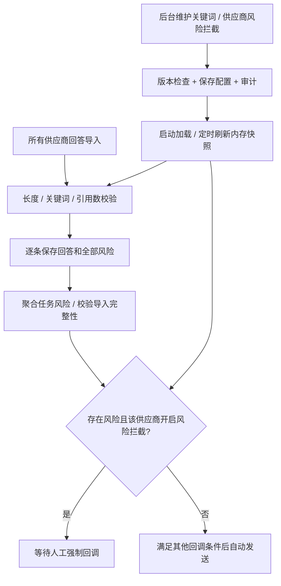

# CDP Router 网关服务技术方案

## 1. 建设目标

CDP Router 是一个 Go 业务网关服务，第一阶段作为 CDP/AI 任务业务代理，对上提供稳定、高并发、可观测的 HTTP API，对下屏蔽供应商或下游 CDP 服务差异。

核心能力：

- 任务记录：记录任务创建、提交、轮询、回调、导入、清洗、失败重试的完整生命周期。
- 结果接入：第一版以供应商上传 OSS + 完成通知为主链路，网关负责签发公网 OSS 上传地址、导入结果、回调业务方。
- 补偿查询：保留对下游任务状态和结果文件的查询能力；worker 会对已提交任务做低频进度刷新和超时处理，结果导入仍以供应商完成回调或手动同步为入口。
- 数据清洗：解析下游 Excel/JSON 结果，做字段标准化、去重、校验、映射、聚合和异常行隔离。
- 出站治理：provider adapter 使用独立 HTTP client、超时、QPS limiter 和并发 semaphore；熔断、透传代理和租户限流属于后续扩展。
- 可扩展接入：通过 provider adapter 适配不同 CDP、Q2A、AI 平台或数据供应商。

## 2. 参考架构约定

参考 `/Users/Mark/Desktop/milun/xinyangzc/xinyangzc-api/docs/architecture.md`，保留以下工程约定：

```text
cmd/<service>/main.go       进程启动和依赖装配
configs/                    运行配置示例
docs/                       架构、接口、运维文档
api/<module>/v1/*.proto     API 协议事实来源
internal/config/            配置、默认值、校验
internal/httpapi/           Gin HTTP Server、路由、中间件、统一响应
internal/service/           HTTP handler 协议转换和 usecase 调用
internal/biz/               业务用例、实体、仓储接口
internal/data/              DB/Redis/OSS/外部服务仓储实现
internal/pkg/               通用基础库
scripts/check.sh            本地统一校验入口
Dockerfile                  多阶段构建镜像
```

整体调用链路：

```text
HTTP Client
  -> internal/httpapi
  -> internal/service
  -> internal/biz
  -> internal/data
  -> downstream provider / database / object storage
```

当前阶段不引入 gRPC 对接方式。protobuf 只作为对外结构、枚举、错误码和接口契约的统一维护入口，Gin 负责真实 HTTP 请求处理，OpenAPI 由 proto 自动生成。

## 3. 推荐技术栈

- 语言：Go 1.22+。
- HTTP Server：Gin，对外提供 HTTP/JSON。
- API 契约：Protocol Buffers 维护 request/response/message/enum/service 定义。
- OpenAPI：通过 proto annotations 自动生成 OpenAPI 3 文档，随构建产物或 `/api/openapi.json` 暴露。
- Admin Web：Vite + React + TypeScript 构建 SPA，由 Go 服务通过 `/admin/*` 内置托管。
- 数据库：PostgreSQL 15+，当前数据库名为 `cdp-admin`。
- DB 访问：`sqlc` 或 `sqlx`。任务状态机和事务边界明确，优先 `sqlc` 获取类型安全 SQL。
- 缓存/会话：Redis 当前用于后台 Session；任务调度游标保存在 PostgreSQL 的 `cdp_dispatch_profiles.cursor`。
- 异步任务：当前使用同进程 worker goroutine；结果导入、业务回调、`SUBMITTED` 进度刷新和超时处理通过数据库状态驱动。
- 文件存储：OSS/S3 兼容对象存储，保存下游原始文件、清洗后文件和错误行报告。
- Excel 解析：`excelize`。
- 配置：JSON 或 YAML，保持参考项目的 configfile + Validate 模式。
- 日志：`log/slog`，JSON 格式，字段包含 `request_id`、`task_id`、`provider_code`、`batch_no`。
- 指标：Prometheus + OpenTelemetry，覆盖 API 延迟、下游耗时、轮询频率、任务状态分布、清洗失败率。

## 4. 项目目录结构

```text
cdp-router/                  仓库根目录
  AGENTS.md
  docs/
    gateway-architecture.md
    current-handoff.md
    AI数据接入文档/
      AI数据来源接口.md
      api.md
  web/
    admin/                   Admin Web 源码，与 Go 服务目录同级
      package.json
      vite.config.ts
      index.html
      src/
        main.tsx
        App.tsx
        pages/
        components/
        layouts/
        api/
        types/
        styles/
  cdp-router/                Go 服务项目目录
    api/
      task/v1/
        task.proto
        task.pb.go
      provider/v1/
        provider.proto
        provider.pb.go
      admin/v1/
        admin.proto
        admin.pb.go
    openapi/
      openapi.yaml
    web/
      admin/
        dist/                 Admin Web 构建产物，镜像打包使用，不作为源码目录
    cmd/
      cdp-router/
        main.go
    configs/
      cdp-router.conf
    internal/
      config/
        config.go
      httpapi/
        server.go
        middleware.go
        openapi.go
        admin_static.go
      service/
        task_service.go
        admin_service.go
      biz/
        task.go
        usecase.go
        admin.go
        customer_adapter.go
      data/
        db.go
        task_repo.go
        admin_repo.go
        platform_user_repo.go
        redis.go
      provider/
        http_provider.go
        file_completion.go
        mpzdata_provider.go
      callback/
        adapter.go
        router.go
        http_callback.go
        yangshi_callback.go
      cleaner/
        excel_parser.go
      worker/
        worker.go
      pkg/
        logger/
        httphelper/
        ossutil/
        timezone/
        trace/
    migrations/
      000001_init.sql
    scripts/
      check.sh
    Makefile
    Dockerfile
    go.mod
```

## 5. API 契约和 OpenAPI 生成

### 5.1 proto 使用方式

当前阶段不生成、不注册 gRPC server，也不使用 grpc-gateway 运行时。proto 的职责是统一维护：

- 对外 request/response 结构。
- 枚举，例如任务状态、供应商状态。
- 错误码和统一响应结构。
- HTTP 方法、路径、请求体和响应体契约。
- OpenAPI 生成所需的接口说明。

建议 proto 仍保留 `service` 定义，并通过 `google.api.http` 标注 HTTP 路由：

```proto
service TaskAPI {
  rpc CreateTask(CreateTaskRequest) returns (CreateTaskResponse) {
    option (google.api.http) = {
      post: "/api/v1/tasks"
      body: "*"
    };
  }

  rpc GetTask(GetTaskRequest) returns (GetTaskResponse) {
    option (google.api.http) = {
      get: "/api/v1/tasks/{id}"
    };
  }
}
```

这里的 `service` 是 API 契约，不代表服务进程必须开放 gRPC 端口。Gin handler 手写注册路由，但必须与 proto annotation 保持一致。

### 5.2 Gin 与 protobuf JSON

Gin handler 不直接使用 `encoding/json` 输出 protobuf message，统一使用 `protojson`，保证 JSON 字段命名、枚举、默认值和 OpenAPI 契约一致。

推荐封装：

```go
func BindProtoJSON(c *gin.Context, msg proto.Message) error {
    body, err := io.ReadAll(c.Request.Body)
    if err != nil {
        return err
    }
    return protojson.UnmarshalOptions{
        DiscardUnknown: false,
    }.Unmarshal(body, msg)
}

func ProtoJSON(c *gin.Context, status int, msg proto.Message) {
    body, err := protojson.MarshalOptions{
        UseProtoNames:   false,
        EmitUnpopulated: true,
    }.Marshal(msg)
    if err != nil {
        c.Status(http.StatusInternalServerError)
        return
    }
    c.Data(status, "application/json; charset=utf-8", body)
}
```

Gin 的职责：

- 路由注册。
- 请求上下文、鉴权、限流、日志、recover、CORS。
- 调用 `service` 层。
- 统一错误响应。

`service` 层职责：

- 将 Gin 请求绑定到 protobuf request。
- 调用 biz usecase。
- 将 biz entity 转换成 protobuf response。
- 将业务错误转换成统一错误结构和 HTTP status。

### 5.3 OpenAPI 自动生成

推荐使用 `buf` 或 Makefile 统一生成：

```text
api/**/*.proto
  -> protoc-gen-go
  -> *.pb.go
  -> protoc-gen-openapi 或 protoc-gen-openapiv2
  -> openapi/cdp-router.openapi.json
```

OpenAPI 生成策略：

- 如果要求 OpenAPI 3，使用支持 OpenAPI 3 的 proto openapi 插件生成 `openapi/cdp-router.openapi.json`。
- 如果现有工具链更偏向 grpc-gateway，可只使用 `protoc-gen-openapiv2` 生成 Swagger v2，再由构建脚本转换为 OpenAPI 3；服务运行时仍不引入 grpc-gateway。
- 生成产物通过 `/api/openapi.json` 暴露，并可通过 `/api/docs` 挂载 Swagger UI 或 Scalar UI。

Makefile 建议：

```makefile
.PHONY: proto openapi

proto:
	protoc -I api -I third_party \
	  --go_out=. --go_opt=paths=source_relative \
	  $$(find api -name '*.proto')

openapi:
	protoc -I api -I third_party \
	  --openapi_out=openapi \
	  $$(find api -name '*.proto')
```

`scripts/check.sh` 是日常代码变更的默认检查入口，不执行任务 E2E；任务 E2E 需要显式运行 `make e2e-test`。默认检查至少执行：

- 非 E2E Go 包测试，例如排除 `./tests/e2e` 后的 `go test`
- `make proto`
- `make openapi`
- 检查生成文件是否有未提交差异。

### 5.4 proto 与 Gin 路由一致性

为了避免手写 Gin 路由和 proto annotation 漂移，建议增加一个路由契约测试：

- 从生成的 OpenAPI JSON 读取 path/method。
- 从 Gin engine 的 `Routes()` 读取实际 path/method。
- 对外 API 必须双向匹配。
- `/health`、`/ready`、`/metrics` 等基础运维接口可以放入白名单。

## 6. 领域模型

### Task

业务任务，来自用户业务系统。例如 AI 问答批次任务。

关键字段：

- `id`：内部任务 ID。
- `job_id`：网关生成的对外任务 ID，对 API 返回时字段名为 `externalBatchId`。
- `provider_external_batch_id`：供应商批次 ID，由供应商 `POST /api/v1/ai/batch/create` 返回。
- `provider_code`：任务实际下发的供应商编码，由接入方绑定的调度配置选出。
- `batch_no`：业务批次号，作为任务幂等键和业务方查询/回调关联键。
- `platform_user_id`、`platform_code`：接入方归属，来自 `platform_users`。
- `dispatch_profile_id`、`dispatch_profile_code`、`dispatch_strategy`：创建任务时使用的调度审计信息；历史任务允许为空。
- `status`：当前实现使用 `CREATED`、`SUBMITTED`、`PROVIDER_DONE`、`RESULT_IMPORTED`、`CALLBACK_PENDING`、`DONE`、`FAILED`、`REASSIGNED`。`REASSIGNED` 只用于被转派的原任务，属于 closed 终态，不再进入后续状态流转；统计报表、供应商/接入方 metrics 和每日聚合不计入 `REASSIGNED` 原任务，只统计继续执行的新转派任务。
- `reassigned_from_task_id`：转派新任务关联的原任务 ID；普通任务为空。
- `callback_batch_no`、`callback_external_batch_id`：转派新任务回调业务方时使用的原始批次号和原始 externalBatchId；普通任务为空并回退使用自身 `batch_no/job_id`。
- `provider_request`、`provider_response`、`raw_request`：保留必要输入输出，方便审计和排障；供应商提交失败时当前只写事件和 `last_error`，成功提交后写入 provider 请求/响应。
- `total_count`、`success_count`、`failed_count`、`last_error`。任务总量按系统实际生成并下发给供应商的任务明细统计，不直接从 `raw_request` 或接入方原始 `items[].seq` 推导。

### TaskItem

任务问题明细，对应业务方提交的 `items[]`，并承载供应商状态查询返回的问题状态。该表只保存任务项身份、问题内容、供应商问题状态和结果导入状态，不保存大段 AI 回答和引用结果。

关键字段：

- `task_id`
- `batch_no`
- `item_id`：业务方提交的单条问题唯一标识。
- `question_id`：供应商状态查询返回的问题 ID。
- `platform_code`
- `seq`：业务方提交的上游轮次/顺序标记，保留用于审计和排障；`seq=2` 只表示第二个轮次或位置，不表示该 item 需要执行两次，也不作为网关侧任务数量扩容依据。
- `question`
- `deepthink`
- `web_search`
- `status`：供应商问题状态，`0` 待处理、`1` 处理中、`2` 处理完成。
- `result_status`：结果导入状态，`PENDING`、`IMPORTED`、`PARSE_FAILED`。
- `result_imported_at`
- `raw_item`

真实接口测试观察：

- `GET /api/v1/ai/batch/external/{externalBatchId}` 返回 `data.questions[]`。
- 当前测试返回的 `questionId` 与提交的 `itemId` 一致，例如 `Q2A2-realflow-20260722100837-001`。
- 数据结构仍保留 `question_id` 独立字段，不强依赖它永远等于 `item_id`。
- 更新问题状态时优先按 `task_id + item_id` 匹配；如果后续供应商返回不同的 `questionId`，再按 `question_id` 建索引和匹配策略。

### 6.1 任务总数口径

任务总数只有一个权威口径：任务创建时实际落库到 `cdp_task_items` 的 item 数。

- 上游业务方提交任务后，网关先生成并落库任务明细；`cdp_tasks.total_count` 必须等于当前任务的 `cdp_task_items` 数。
- 下发给供应商的任务明细数量必须等于该总数；供应商提交响应中的 `acceptedCount` 如果非 0，必须等于该总数，否则提交失败并记录 `PROVIDER_SUBMIT_FAILED`。
- 供应商 `status_url` 或完成 callback 返回的 `totalCount / successCount / failedCount` 只用于和本地任务总数做校验，不允许反向覆盖本地任务总数。
- 结果导入后的 `success_count / failed_count` 按 item 维度统计：一个 item 只要存在至少一条 `parse_status='SUCCESS'` 的结果，就计为成功；没有成功但存在失败结果时计为失败。
- `cdp_task_item_results` 可以按 `seq` 保存同一 item 的多轮结果；该 `seq` 是结果轮次编号，不表示“需要执行几次”，多轮结果不能扩大任务总数。
- 回调 readiness、后台手动回调提示、最终业务方 callback payload 的 `counts.total` 都必须使用本地任务总数。

### Provider

下游服务配置和能力声明。第一版不做 provider 数据库维护和后台管理 API，通过配置文件 `[providers.<code>]` 简单维护，服务启动时一次性加载到内存并常驻；配置变更后重启服务生效。

新增 provider 的完整接入步骤见 `docs/provider-onboarding.md`。实现原则：

- 通用协议一致时只增加配置，不新增代码。
- 完成文件处理有差异时，在 `internal/provider/<provider_code>_provider.go` 中实现 provider 自己的 `fileCompletion`。
- 提交、状态、文件列表、下载协议有差异时，新增独立 provider adapter 实现 `biz.ProviderClient`。
- 不允许在 biz/service/httpapi 层硬编码 provider code。

- `provider_code`
- `display_name`
- `company_name`：供应商公司名称，用于后台展示和接入方任务对账单导出；未配置时回退使用 `display_name`。
- `settlement_start_at`：供应商开始结算时间，配置为 `YYYY-MM-DD` 或 RFC3339 字符串，用于后台展示和运营对账识别。
- `token`：用于 `X-Provider-Token` 校验，也是网关调用供应商接口时的优先鉴权头。
- `api_key`：用于 `X-API-Key` 鉴权；当 `token` 为空且 `api_key` 非空时，网关调用供应商接口使用该字段。
- `bucket_path_prefix`：该 provider 的 OSS object key 前缀。
- `submit_url`
- `status_url`
- `files_url`
- `timeout_seconds`

### Result

任务结果和清洗产物。结果必须保存到数据库，不能只保存文件 URL。

任务相关表不使用数据库 foreign key 约束；通过 `task_id`、`task_item_id`、`result_file_id` 等业务关联字段和索引维护查询关系，避免清表、重入和运维修复被外键约束阻断。

关键字段：

- `task_id`
- `batch_no`
- `external_batch_id`
- `file_url`
- `file_name`
- `row_count`
- `valid_row_count`
- `invalid_row_count`
- `checksum`
- `schema_version`

### TaskItemResult

每个问答轮次的稳定平铺结果，后台页面和业务最终结果展示优先读取该表。供应商 Excel 中 `AI回答` sheet 的一行对应 0 或 1 条 `TaskItemResult`；同一 `itemId` 多次出现时不能去重丢弃，而是按出现顺序生成结果轮次 `seq=1,2,...` 并分别保存。`溯源信息` sheet 的多行引用按 `itemId + seq` 聚合到对应结果的 `references_json`；如果溯源 sheet 没有轮次字段，则作为兼容数据复用到该 `itemId` 的各轮结果。

关键字段：

- `task_id`
- `task_item_id`
- `batch_no`
- `item_id`
- `seq`：结果轮次编号，来自 Excel `AI回答` 同一 `itemId` 的出现顺序，或结果文件显式轮次字段。
- `platform_code`
- `question`
- `answer_text`
- `thinking_process`
- `generated_at`
- `generated_at_text`
- `recommended_questions`
- `device_id`
- `recording_url`
- `references_json`
- `cleaned_payload`
- `parse_status`
- `parse_error`
- `result_file_id`
- `answer_sheet_row_index`
- `reference_count`
- `row_hash`

### ResultRow

供应商结果文件解析后的原始结构化行数据。该表用于审计、排障和重新解析，不作为最终业务展示表。结果行保留 `seq` 便于追溯某一行属于第几轮回答；非问答行或无轮次信息时可为 0。

关键字段：

- `task_id`
- `batch_no`
- `external_batch_id`
- `result_file_id`
- `sheet_name`
- `row_index`
- `item_id`
- `seq`
- `row_data`
- `row_hash`
- `parse_error`

## 7. 数据库设计草案

数据库使用 PostgreSQL，数据库名为 `cdp-admin`。结果数据必须按 batch 幂等入库。当前按无历史数据处理，第一版不保留补偿获取 attempts 表。

### 查询与写入性能约定

- 常规任务查询和 worker 扫描不加载 `result_payload`；完整 payload 保留在数据库，按需通过独立仓储方法读取。对外任务响应和结构化结果接口契约不变。
- 后台任务列表先按筛选条件和 `created_at DESC, id DESC` 取当页任务，再聚合明细；成功/失败按 item 维度一次聚合，成功优先于失败。详情先分页轮次、状态等窄字段，再加载回答、引用等大字段；保留缺失轮次和错误优先排序。
- 任务名搜索仅在模式不可能匹配空字符串时增加 `task_name <> ''`，命中现有部分 GIN 索引，同时保留已有 LIKE 通配符语义。
- 完成导入时锁定任务，在一次结果统计后决定回调就绪状态；相同状态、计数和导入时间不再重复 UPDATE。已有 CALLBACK_PENDING/DONE 状态处理语义保持不变。进度同步跳过没有变化的 item。
- 本轮优化不调整 API、状态枚举或调度周期，不删除历史结果、不在线增删索引。索引维护候选及观测依据见 `docs/database-performance-review-2026-09-30.md`。

```sql
create table cdp_tasks (
  id bigserial primary key,
  job_id varchar(64),
  platform_user_id bigint,
  platform_code varchar(64),
  batch_no varchar(128) not null,
  provider_code varchar(64) not null,
  gateway_code varchar(64),
  source varchar(128),
  external_batch_id varchar(128),
  provider_external_batch_id varchar(128),
  reassigned_from_task_id bigint,
  callback_batch_no varchar(128),
  callback_external_batch_id varchar(128),
  dispatch_profile_id bigint,
  dispatch_profile_code varchar(64),
  dispatch_strategy varchar(32),
  biz_date date,
  status varchar(32) not null,
  callback_url text,
  provider_callback_url text,
  raw_request jsonb not null,
  provider_request jsonb,
  provider_response jsonb,
  result_payload jsonb,
  result_object_key text,
  result_file_name text,
  total_count int not null default 0,
  success_count int not null default 0,
  failed_count int not null default 0,
  result_row_count int not null default 0,
  last_error text,
  submitted_at timestamptz,
  provider_finished_at timestamptz,
  result_imported_at timestamptz,
  callback_sent_at timestamptz,
  created_at timestamptz not null default now(),
  updated_at timestamptz not null default now(),
  unique (batch_no)
);

create unique index idx_cdp_tasks_job_id
  on cdp_tasks(job_id)
  where job_id is not null;

create index idx_cdp_tasks_status_created_at
  on cdp_tasks(status, created_at);

create index idx_cdp_tasks_dispatch_profile_created_at
  on cdp_tasks(dispatch_profile_id, created_at)
  where dispatch_profile_id is not null;

create index idx_cdp_tasks_reassigned_from_task_id
  on cdp_tasks(reassigned_from_task_id)
  where reassigned_from_task_id is not null;

create index idx_cdp_tasks_provider_callback_batch_no
  on cdp_tasks(provider_code, callback_batch_no, created_at desc)
  where reassigned_from_task_id is not null and callback_batch_no is not null and deleted_at is null;

create table cdp_task_items (
  id bigserial primary key,
  task_id bigint not null,
  batch_no varchar(128) not null,
  item_id varchar(128) not null,
  question_id varchar(128),
  platform_code varchar(64) not null,
  seq int not null,
  question text not null,
  deepthink boolean not null default false,
  web_search boolean not null default false,
  status int not null default 0,
  result_status varchar(32) not null default 'PENDING',
  result_imported_at timestamptz,
  raw_item jsonb not null,
  created_at timestamptz not null default now(),
  updated_at timestamptz not null default now(),
  unique (task_id, item_id)
);

create index idx_cdp_task_items_question_id
  on cdp_task_items(task_id, question_id);

create index idx_cdp_task_items_detail_priority
  on cdp_task_items(
    task_id,
    (
      case
        when result_status in ('FAILED','PARSE_FAILED','ERROR') then 0
        when result_status <> 'IMPORTED' or status <> 2 then 1
        else 2
      end
    ),
    seq,
    id
  );

create table cdp_task_events (
  id bigserial primary key,
  task_id bigint not null,
  event_type varchar(64) not null,
  payload jsonb,
  created_at timestamptz not null default now()
);

create index idx_cdp_task_events_task_id
  on cdp_task_events(task_id, created_at);

create table cdp_task_result_files (
  id bigserial primary key,
  task_id bigint not null,
  batch_no varchar(128) not null,
  external_batch_id varchar(128) not null,
  source_type varchar(32) not null,
  object_key text,
  file_url text,
  file_name varchar(255),
  checksum varchar(128),
  parse_status varchar(32) not null,
  row_count int not null default 0,
  valid_row_count int not null default 0,
  invalid_row_count int not null default 0,
  last_error text,
  fetched_at timestamptz,
  parsed_at timestamptz,
  created_at timestamptz not null default now(),
  updated_at timestamptz not null default now(),
);

create unique index idx_cdp_task_result_files_object_key
  on cdp_task_result_files(batch_no, object_key)
  where object_key is not null;

create unique index idx_cdp_task_result_files_file_url
  on cdp_task_result_files(batch_no, file_url)
  where file_url is not null;

-- 供应商 files 接口在任务未完成或暂无文件时返回 fileUrls=[]，
-- 此时不创建 cdp_task_result_files 记录，只记录日志或任务事件。

create table cdp_task_item_results (
  id bigserial primary key,
  task_id bigint not null,
  task_item_id bigint not null,
  batch_no varchar(128) not null,
  item_id varchar(128) not null,
  platform_code varchar(64),
  question text,
  answer_text text,
  thinking_process text,
  generated_at timestamptz,
  generated_at_text varchar(64),
  recommended_questions jsonb not null default '[]'::jsonb,
  device_id varchar(128),
  recording_url text,
  references_json jsonb not null default '[]'::jsonb,
  cleaned_payload jsonb not null,
  parse_status varchar(32) not null default 'SUCCESS',
  parse_error text,
  result_file_id bigint not null,
  seq int not null default 1,
  answer_sheet_row_index int,
  reference_count int not null default 0,
  row_hash varchar(128),
  created_at timestamptz not null default now(),
  updated_at timestamptz not null default now()
);

create unique index idx_cdp_task_item_results_task_item_seq
  on cdp_task_item_results(task_item_id, seq);

create index idx_cdp_task_item_results_task_id_seq
  on cdp_task_item_results(task_id, item_id, seq);

create index idx_cdp_task_item_results_batch_no_seq
  on cdp_task_item_results(batch_no, item_id, seq);

create table cdp_task_result_rows (
  id bigserial primary key,
  task_id bigint not null,
  batch_no varchar(128) not null,
  external_batch_id varchar(128) not null,
  result_file_id bigint not null,
  sheet_name varchar(128) not null,
  row_index int not null,
  item_id varchar(128),
  seq int not null default 0,
  row_data jsonb not null,
  row_hash varchar(128),
  parse_error text,
  created_at timestamptz not null default now(),
  updated_at timestamptz not null default now(),
  unique (result_file_id, sheet_name, row_index)
);

create table cdp_task_callbacks (
  id bigserial primary key,
  task_id bigint not null,
  target_url text not null,
  request_payload jsonb,
  response_status int,
  response_body text,
  status varchar(32) not null,
  retry_count int not null default 0,
  last_error text,
  created_at timestamptz not null default now(),
  updated_at timestamptz not null default now()
);
```

## 8. 核心流程

### 8.0.1 接入方 API Key 与对外任务 ID

网关在供应商 `provider` 之外增加接入方配置 `platform_users`。`provider` 表示网关对下游供应商的配置，`platform_users` 表示调用网关的业务接入方配置。

第一版 `api_key` 按明文保存和查询，不做哈希、不做前后缀展示处理；但日志仍不得打印完整 `api_key`。

```sql
create table platform_users (
  id bigserial primary key,
  platform_code varchar(64) not null,
  name varchar(128) not null,
  api_key varchar(256) not null,
  status varchar(32) not null default 'ACTIVE',
  default_provider_code varchar(64),
  callback_mode varchar(64) not null default 'DEFAULT_HTTP',
  callback_url text,
  callback_config jsonb not null default '{}'::jsonb,
  created_at timestamptz not null default now(),
  updated_at timestamptz not null default now()
);

create unique index idx_platform_users_platform_code
  on platform_users(platform_code);

create unique index idx_platform_users_api_key
  on platform_users(api_key);

create table cdp_dispatch_profiles (
  id bigserial primary key,
  platform_user_id bigint not null,
  code varchar(64) not null,
  name varchar(128) not null,
  strategy varchar(32) not null default 'ROUND_ROBIN',
  enabled boolean not null default true,
  cursor bigint not null default 0,
  last_provider_code varchar(64),
  config jsonb not null default '{}'::jsonb,
  created_at timestamptz not null default now(),
  updated_at timestamptz not null default now(),
  unique (platform_user_id),
  unique (code)
);
```

`platform_users.default_provider_code` 仅保留为历史兼容字段，迁移期可用于一次性 seed；运行期供应商选择只读取 `cdp_dispatch_profiles`。

`cdp_tasks` 增加接入方归属和网关对外任务 ID：

```sql
alter table cdp_tasks add column job_id varchar(64);
alter table cdp_tasks add column platform_user_id bigint;
alter table cdp_tasks add column platform_code varchar(64);
alter table cdp_tasks add column provider_external_batch_id varchar(128);
alter table cdp_tasks add column dispatch_profile_id bigint;
alter table cdp_tasks add column dispatch_profile_code varchar(64);
alter table cdp_tasks add column dispatch_strategy varchar(32);
alter table cdp_tasks add column quota_date date;

create unique index idx_cdp_tasks_job_id
  on cdp_tasks(job_id)
  where job_id is not null;

create index idx_cdp_tasks_platform_user_created_at
  on cdp_tasks(platform_user_id, created_at);

create index idx_cdp_tasks_provider_external_batch_id
  on cdp_tasks(provider_external_batch_id)
  where provider_external_batch_id is not null;

create index idx_cdp_tasks_provider_quota_date_quota
  on cdp_tasks(provider_code, quota_date, status)
  include (total_count, provider_external_batch_id)
  where deleted_at is null;
```

字段语义：

| 字段 | 面向对象 | 说明 |
| --- | --- | --- |
| `job_id` | 接入方/网关 | 网关生成的对外任务 ID，对 API 返回时字段名为 `externalBatchId` |
| `provider_external_batch_id` | 网关/供应商 | 供应商创建任务后返回的 `externalBatchId` |
| `platform_user_id` | 网关内部 | 标记本任务由哪个接入方 API key 发起 |
| `platform_code` | 网关内部/后台 | 接入方唯一编码，来自 `platform_users.platform_code` |
| `dispatch_profile_id` / `dispatch_profile_code` / `dispatch_strategy` | 网关内部/后台 | 任务创建时使用的调度配置审计字段。历史任务不要求回填，缺失时后台展示为 `-` |
| `quota_date` | 网关内部/调度 | 供应商每日额度归属日期，按任务实际提交到供应商时的 Asia/Shanghai 自然日计算，不使用上游 `biz_date` |

第一阶段不新增独立 provider 表，供应商能力和每日 question 额度仍来自配置文件 `[providers.<code>]`。`daily_question_quota` 未配置或小于等于 0 时表示该 provider 当天无额度上限；配置为正数时，调度按 `cdp_tasks.total_count` 汇总该 provider 在 `quota_date` 当天已占用 question 数，不扫描 `cdp_task_items` 大表。

第一阶段也不新增 `cdp_dispatch_daily_counters` 或 `cdp_task_dispatch_records`。额度实时统计来自 `cdp_tasks` 事实表；调度决策、规则命中、候选供应商和额度快照写入 `cdp_task_events`。

接入方调用网关统一使用：

```http
X-API-Key: <platform_user.api_key>
```

为兼容历史调用方，任务创建和接入方查询接口也接受：

```http
X-Provider-Token: <platform_user.api_key>
```

两种 header 都表示接入方 `platform_users.api_key`；如果两个 header 同时存在，优先使用 `X-Provider-Token`。该兼容不改变供应商回调/上传接口的鉴权语义，`/external/*` 仍使用 provider 配置中的 token。

网关按明文 `api_key` 查询 `platform_users`，校验 `status=ACTIVE` 后写入任务归属。任务查询接口必须按 `platform_user_id + job_id` 校验归属，禁止跨接入方读取。

### 8.0 服务级时序图

本项目第一版流程只涉及 3 个服务角色：用户业务系统、CDP 网关服务、供应商。网关内部数据库、worker、OSS client 等实现细节不在该图中展开。

图中红色节点为供应商文档中定义的接口调用点。第一版以 OSS 上传和完成通知为主链路；状态查询用于人工补偿和 worker 低频进度刷新，结果文件导入不依赖全量轮询调度。


说明：

- 用户业务系统提交任务时，必须带 `X-API-Key` 或兼容 header `X-Provider-Token`；header 值均为 `platform_users.api_key`。请求体 `providerCode` 仅保留协议兼容，不参与供应商选择，网关始终使用绑定在该 `platform_user_id` 上的 `cdp_dispatch_profiles` 做整任务级供应商选择。
- 文档中存在两个不同上下文的 `providerCode`：业务方调用网关创建任务时的请求体 `providerCode` 是兼容字段，会被忽略；网关调用下游供应商、供应商回调网关时的 `providerCode` 是实际选中的供应商编码，来自 dispatch profile。
- 请求体 `callbackUrl` 只影响网关处理完成后回调接入方的地址，可覆盖 `platform_users.callback_url`。它不会作为供应商回调网关的地址下发；阳狮定制回调未传 `callbackUrl` 时，fallback 到 `platform_users.<code>.callback_config` 中的 `baseURL + /external/callback/{providerCode}`。
- 网关创建 `job_id`，对接入方统一返回为 `externalBatchId`；创建任务响应不返回内部 `taskId`。
- 网关提交给供应商时，使用供应商文档中的 `POST /api/v1/ai/batch/create`；请求里的 `callbackUrl` 由 `server.public_base_url + /external/callback/{providerCode}` 生成，线上为 `https://openapi.mainland.vip/external/callback/{providerCode}`。保存返回的 `externalBatchId` 到 `provider_external_batch_id`。
- 系统内部统一约定：`seq` 只代表轮次/位置，不代表要执行几次；任务总数只看 `cdp_task_items` 的 item 数。mpzdata 供应商接口中的 `items[].seq` 语义不同，它表示单条问题的执行次数。网关提交给 mpzdata 且业务只要求执行一次时，供应商请求里的 `seq` 必须改写为 `1`，不得直接透传接入方原始 `seq`。当前阳狮来源接入方（`platform_code=yangshi` 或 `yangshi_*`）走该兼容改写；其他接入方不做改写。
- 面向特定接入方的请求兼容改写统一放在 `internal/biz/customer_adapter.go`，由提交链路在调用 provider adapter 前执行。后续其他客户有字段语义、默认值或兼容格式差异时，在 customer adapter 中增加规则，不把客户特判散落到 service、usecase 主流程或 provider adapter。
- 供应商任务创建成功后，网关才向业务方返回任务创建成功；供应商创建失败时任务标记 `FAILED` 并返回失败。
- 供应商完成后先申请 OSS 上传地址，上传 Excel 后再调用完成通知。
- 网关读取 OSS 文件并保存结构化结果后，再按业务端提交时的 `callbackUrl` 或接入方默认回调地址推送最终状态和结果 URL。
- 补偿查询接口可手动查询供应商状态和结果文件；worker 只对 `SUBMITTED` 任务做低频状态刷新和超时兜底，不负责重新提交 `CREATED` 任务。

### 8.1 创建任务

```text
Client
  -> POST /api/v1/tasks
  -> service 通过 X-API-Key 或 X-Provider-Token 识别 platform_user
  -> biz 生成 job_id
  -> data 在事务内锁定 platform_user_id 对应的 cdp_dispatch_profiles
  -> data 按 dispatch strategy 从 config.providers / config.rules 选择候选供应商
  -> data 按 provider_code + quota_date 加 advisory transaction lock，并基于 cdp_tasks.total_count 统计每日 question 额度
  -> data 选择一个有效供应商并推进 cursor
  -> data 在事务内写 platform_user_id + dispatch 审计字段 + provider_code + cdp_tasks + cdp_task_items + cdp_task_events
  -> biz 同步调用 provider submit_url
  -> provider 创建成功后更新 provider_external_batch_id / SUBMITTED
  -> 返回 externalBatchId=job_id
```

设计要点：

- 幂等键当前以 `batch_no` 为准；`job_id` 由网关生成并返回给接入方。`Idempotency-Key` 属于后续扩展，不是当前实现。
- 分发粒度是整任务维度，不按 `items[]` 或子任务拆分。一个任务选中一个供应商后，全部明细都提交给该供应商。
- `cdp_dispatch_profiles.enabled=false` 时创建任务失败，返回“任务调度未启用”。
- 调度配置中的 `config.providers` 为空、格式非法，或所有 provider code 都无法在当前 provider registry 中找到时，创建任务失败，返回“供应商服务不可用”，且不创建 `cdp_tasks`。在 `ROUND_ROBIN` 下 `config.providers` 表示默认供应商池；在 `RULE_BASED` 下 `config.providers` 表示兜底 `FALLBACK` 供应商池。
- `ROUND_ROBIN` 按默认供应商池和游标轮询；如果配置了 provider 每日额度，剩余额度不足的 provider 会被跳过。
- `RULE_BASED` 读取 `cdp_dispatch_profiles.config.rules`，按 `sortOrder` 和数组顺序使用第一条命中 `taskName` 正则的规则。命中规则后任务获得该规则的 `labels`，并优先从规则的 `providerCodes` 中选择供应商；规则供应商池可以不包含在 `FALLBACK` 池内，只要求 provider 在当前 provider registry 中可用。
- `RULE_BASED` 未命中规则，或命中规则但规则供应商池全部额度不足/不可用时，进入 `FALLBACK` 供应商池；规则池失败进入 fallback 时，任务标签记录为 `fallback`。
- `RULE_BASED` 规则供应商池固定按 `used_questions / daily_question_quota` 最低优先分配；`FALLBACK` 供应商池由 `config.fallbackSelectionPolicy` 控制，可选 `ROUND_ROBIN` 或 `LOWEST_USAGE_RATE`，未配置时默认 `LOWEST_USAGE_RATE`。未配置额度的 provider 视为无上限，并用候选池中最大已配置额度作为均衡分母参与打散。
- 幂等命中已有任务时直接返回已有任务，不推进调度游标。
- 创建接口必须同步完成供应商任务创建；供应商创建失败时，对接入方返回失败。
- 供应商创建失败的任务仍保留数据库记录，状态为 `FAILED`，用于排障。
- 创建成功响应只返回 `externalBatchId=job_id` 和 `acceptedCount`，不返回内部 `taskId`。

### 8.2 提交下游

当前任务创建接口必须同步完成供应商任务创建，只有供应商下发成功后才向接入方返回创建成功。worker 当前不扫描 `CREATED` 任务执行提交，避免和创建接口同步下发形成重复提交；worker 只处理结果导入、业务方回调和 `SUBMITTED` 进度刷新。`SUBMITTED` 超过 24 小时自动置为 `FAILED` 的兜底逻辑已暂时停用。

针对当前供应商任务下发接口，由 provider adapter 调用：

- `POST /api/v1/ai/batch/create`
- Header: `X-Provider-Token`
- 保存返回的 `data.externalBatchId` 到 `provider_external_batch_id`

### 8.3 OSS 上传和完成通知主链路

```text
Provider
  -> POST /external/oss/{providerCode}/upload-url
  -> 网关校验 X-Provider-Token
  -> 网关按 batchNo 找到任务
  -> 签发 OSS PUT URL
  -> 保存 result_object_key/result_file_name
  -> 返回 bucket/key/uploadUrl/method/expiresAt/headers
Provider
  -> PUT uploadUrl 上传 Excel
  -> POST /external/callback/{providerCode}
Gateway
  -> 校验 callback counts 是否 100% 完成
  -> 调供应商 files_url 获取文件地址列表
  -> 只登记 cdp_task_result_files 待导入文件；本项目 OSS 地址仅做 HeadObject/ObjectExists
  -> 标记 PROVIDER_DONE
Worker
  -> 读取待导入文件记录
  -> 读取 OSS object 或下载外部文件 URL
  -> 解析、清洗、幂等保存结果
  -> 确认所有 cdp_task_items.result_status='IMPORTED' 且 success_count + failed_count = total_count
  -> 标记 CALLBACK_PENDING
  -> callback worker 通知业务方
```

OSS 签名约束：

- 当前 bucket 为 `opensource-man`。
- 供应商可访问的公网域名为 `https://opensource-man.oss-cn-shanghai.aliyuncs.com`。
- 不使用 CNAME。
- 不返回 `oss-cn-shanghai-internal.aliyuncs.com` 等内网 endpoint。
- 供应商上传的任务结果文件不是临时文件，不设置 7 天删除 tag；后台导出下载生成的临时 Excel 文件才写入 OSS 临时目录，并打 `cdp-temp=true`、`expire-days=7` tag。

### 8.4 回调扩展方式

默认 `DEFAULT_HTTP` 回调：网关向任务 `callback_url` 发送 `externalBatchId`、`batchNo`、`status`、`counts` 和 `resultUrl`。

接入方编码或回调模式匹配 `yangshi` 关键词时，统一使用阳狮/Wiredcraft 定制回调链路，配置项放在各自接入方的 `callback_config` 中。网关按结果 Excel 通知阳狮/Wiredcraft：先申请对方 OSS 上传地址，再 PUT 上传 Excel，最后调用完成通知接口。

业务方回调必须满足以下门槛后才允许触发：

- 供应商完成确认已成功入库，任务已进入 `PROVIDER_DONE`。完成确认可以来自供应商 `/external/callback/{providerCode}`，也可以来自主动检查 `status_url` 返回的标准数量校验结果。
- 所有结果文件导入流程已经结束，不允许单个文件导入成功后提前置为 `CALLBACK_PENDING`。
- 所有 `cdp_task_items.result_status='IMPORTED'`。
- 任务汇总满足 `success_count + failed_count = total_count`。

后台手动回调必须先做同一套数量校验：

- 已经回调成功的 `DONE` 任务、以及业务回调失败后进入 `FAILED` 的任务，都允许后台发起重复回调。
- 数量一致时，直接重新回调业务方。
- 数量不一致时，不自动回调，接口返回当前 `success_count / total_count`、校验原因和 `forceRequired=true`，后台页面展示二次确认。
- 运维二次确认强制回调时，只使用当前已成功导入的结果内容生成回调 payload 或定制 Excel，不把未导入、空回答或失败项混入强制回调结果。

如果同一个任务存在多份结果文件，定制回调必须先合并成一份 Excel 再上传给阳狮/Wiredcraft：

- 同名 sheet 追加合并。
- 表头只保留第一份文件的第一行。
- 合并文件名使用 `<batchNo>-result.xlsx`。
- 原始文件仍按 batch 保留在 `cdp_task_result_files`，用于排障、重入和后台展示。

单文件或合并前的原始文件来源优先级为：

1. `cdp_tasks.result_object_key` 指向的本项目 OSS 原始文件。
2. `cdp_task_result_files.object_key` 指向的本项目 OSS 原始文件。
3. `cdp_task_result_files.file_url`。若判断为本项目 OSS 域名则转 OSS object 读取，否则用 HTTP 下载外部文件。

阳狮定制配置示例：

```json
{
  "baseURL": "https://staging-api-growth.wiredcraft.cn/api2",
  "providerCode": "vendor_a",
  "providerToken": "vendor-provider-token"
}
```

`baseURL` 和 `providerCode` 必须从 conf 读取；`providerToken` 为空时回退使用该 `platform_user.api_key`。

代码目录保留标准定制接入方式：

```text
internal/callback/
  adapter.go          回调 adapter 接口和 registry
  http_callback.go    DEFAULT_HTTP 实现
  yangshi_callback.go 阳狮/Wiredcraft 定制上传文件 + 完成通知实现；多文件先合并为单份 Excel
```

后续接入其他定制网关时，新增独立 adapter，实现统一接口并按 `platform_users.callback_mode` 与 `platform_code` 选择即可。定制 adapter 只负责目标网关的 header、鉴权、字段映射和响应错误映射，不应把定制 payload 拼接逻辑散落到 biz 或 service 层。

后台支持对单个任务重试回调：

```http
POST /api/admin/v1/tasks/{id}/retry-callback
```

该接口只重试指定任务，重新生成当前任务状态和 `resultUrl` payload，并写入 `cdp_task_callbacks` 与后台审计日志。

### 8.5 补偿查询接口

当前不启动独立结果轮询调度；状态查询既可由手动补偿接口触发，也可由 worker 对 `SUBMITTED` 任务做低频进度刷新：

当前供应商查询接口：

- `GET /api/v1/ai/batch/external/{externalBatchId}`：查询问题状态，状态 `0` 待处理、`1` 处理中、`2` 处理完成。
- `GET /api/v1/ai/batch/external/{externalBatchId}/files`：查询处理结果文件地址列表。
- 两个接口均使用 Header `X-Provider-Token` 鉴权。

状态判断说明：

- `questions[].status=1` 只表示该问题仍在处理中，不表示批次完成，也不表示结果文件已经生成。
- 供应商完成确认的标准来源有两个：供应商完成 callback，或 `status_url` 返回 `successCount + failedCount = 本地任务 item 数` 且 `totalCount` 为空或等于本地任务 item 数。
- `questions[].status` 用于保存问题级进度和兼容判断是否可以尝试拉取结果文件；仅 `questions[].status` 全部为 `2` 不会生成 providerCallback，也不会把任务推进为 `PROVIDER_DONE`。
- 如果任一问题仍为 `0` 或 `1`，`sync-provider-result` 只更新本地问题状态，不查询、不导入结果文件；此时供应商 `files_url` 返回 `fileUrls=[]` 属于预期。
- 如果所有问题都为 `2` 但 `fileUrls=[]`，表示供应商已完成状态和文件生成之间存在延迟，或供应商 files 接口尚未写入文件记录；可稍后重试 `sync-provider-result`。
- 网关对外统一在补偿查询响应 `data.msg` 和顶层 `message` 返回供应商说明文案。`mpzdata` 会返回“已处理 x/y，结果文件已/未生成”的进度说明；后续其他 provider 可以按 adapter/provider code 扩展自己的文案。

真实测试返回示例：

```json
{
  "success": true,
  "message": "查询成功",
  "data": {
    "externalBatchId": "bb3158f840d045bd93dfdb50e3d37d02",
    "questions": [
      {
        "questionId": "Q2A2-realflow-20260722100837-001",
        "status": 0
      },
      {
        "questionId": "Q2A2-realflow-20260722100837-002",
        "status": 0
      }
    ]
  },
  "code": 200
}
```

结果文件接口在任务未完成时返回：

```json
{
  "success": true,
  "message": "查询成功",
  "data": {
    "externalBatchId": "bb3158f840d045bd93dfdb50e3d37d02",
    "fileUrls": []
  },
  "code": 200
}
```

当供应商返回如下处理中状态时：

```json
{
  "status": 0,
  "message": "",
  "data": {
    "externalBatchId": "b1642d69ddad4afeaa629a2ce57c2348",
    "questions": [
      {
        "questionId": "MPZ-ONLINE-20260724161142-deepseek",
        "status": 1
      }
    ]
  }
}
```

网关应解释为“供应商仍在处理中”，不能进入文件导入链路；需要等待所有问题 `status=2`，再查询 `files_url`。

网关侧保留接口：

- `GET /api/v1/tasks/{id}/provider-status`：查询并保存供应商问题状态。
- `GET /api/v1/tasks/{id}/provider-result-files`：查询供应商结果文件列表。
- `POST /api/v1/tasks/{id}/refetch-result`：重新拉取供应商文件列表并导入结果。
- `POST /api/v1/tasks/{id}/sync-provider-result`：主动查询供应商状态；如果供应商已全部完成，则查询结果文件、下载解析并幂等重入结果。

后台第一版只提供 API：

- `POST /api/admin/v1/login`：后台登录，使用 `[admin.bootstrap]` 配置初始化用户，签发 HttpOnly Session Cookie。
- `POST /api/admin/v1/logout`：后台退出，删除 Redis session。
- `GET /api/admin/v1/me`：查询当前登录用户。
- `GET /api/admin/v1/tasks`：任务列表，支持 `taskName` 模糊搜索，以及 `batchNo`、`source`、`platformCode`、`providerCode`、创建时间范围、执行结果状态筛选。后台任务列表页的 `providerCode` 筛选必须使用供应商下拉选择，筛选条件本地缓存，用户从详情页返回时保留上一次筛选和分页。
- `GET /api/admin/v1/tasks/{id}`：任务详情，展示任务、问答完成情况、结构化结果、结果文件、业务方回调记录和事件。回调记录来自 `cdp_task_callbacks`，包含目标地址、请求 payload、HTTP 响应状态、响应体、错误信息和创建/更新时间。
- `POST /api/admin/v1/tasks/{id}/check-result`：检查结果，默认 `force=true`、`notifyCallback=true`，复用主动查询供应商进度和结果重入链路。
- `POST /api/admin/v1/tasks/{id}/retry-callback`：按单个任务重新触发业务方完成通知，写入新的 `cdp_task_callbacks` 记录并刷新任务详情中的回调结果。
- `POST /api/admin/v1/tasks/reassign`：按原始 `batchNo` 和目标 `providerCode` 手动转派任务。仅允许转派尚未进入 `CALLBACK_PENDING`、`DONE`、`REASSIGNED` 的原始任务；已经转派过的源任务、以及由转派产生的新任务，都不允许再次转派。转派成功后原任务标记 `REASSIGNED`，新任务按普通任务链路继续流转。
- `DELETE /api/admin/v1/tasks/{id}`：仅允许软删除供应商提交失败的失败任务，即任务状态为 `FAILED` 且存在 `PROVIDER_SUBMIT_FAILED` 事件；只写入 `cdp_tasks.deleted_at/deleted_by` 并从后台列表和详情隐藏，任务记录、事件、明细、结果文件记录、结果行和回调记录必须保留，同时写入后台审计日志。`batch_no` 唯一性只约束未删除任务，软删除后允许同批次重新提交。
- `GET /api/admin/v1/providers`：供应商列表，只读展示配置加载后的供应商编码、名称、启用状态、结果模式、QPS、并发、OSS 前缀和接口配置状态，不返回 token。
- `GET /api/admin/v1/dispatch-options`：返回后台可选调度策略和可下发 provider 列表。provider 必须在配置中启用，并具备提交 URL 和鉴权 token/API key。
- `GET /api/admin/v1/providers/{providerCode}/metrics`：供应商数据详情指标，支持 `createdFrom`、`createdTo` 创建时间范围筛选，按天聚合任务数、问答数、成功问答数量和失败/未回答数量。
- `GET /api/admin/v1/platform-users`：接入方列表，支持关键字和状态筛选。
- `GET /api/admin/v1/platform-users/{id}`：接入方详情。
- `GET /api/admin/v1/platform-users/{id}/metrics`：接入方数据详情指标，支持 `createdFrom`、`createdTo` 创建时间范围筛选，按真实任务、问题、结果文件、回调表和供应商维度聚合提交任务数、完成问答数、进行中任务数、失败任务数、任务成功率、任务平均耗时等排障指标。供应商维度按天和 `providerCode` 聚合任务数、问答数、成功问答数量和失败/未回答数量。后台页面默认按当前自然月查询，自定义范围只选择日期，服务端按传入的起止时间精确过滤。
- `POST /api/admin/v1/platform-users/{id}/reconciliation-export`：接入方任务对账单导出，入参为 `createdFrom`、`createdTo`。导出仅包含所选创建时间范围内存在成功业务回调记录的任务，表头为：日期、任务名称、任务batchNo、供应商code、供应商公司名称、问答数。供应商公司名称来自 provider 配置 `company_name`，未配置时回退 `display_name`。
- `POST /api/admin/v1/platform-users`：新增接入方，自动生成明文 `apiKey`，后台不提供手工输入。
- `PUT /api/admin/v1/platform-users/{id}`：编辑接入方名称、编码、状态、调度配置、回调方式和回调 URL；不允许编辑 `apiKey`。

任务创建请求支持 `source` 字段，后台列表按 `source` 展示来源；如果业务方未传 `source`，服务端回退使用接入方 `platform_code`。

供应商和接入方详情中的“问答数”按系统实际生成并下发的任务明细统计，优先读取 `cdp_task_items` 和已导入的 `cdp_task_item_results`，不从 `raw_request` 或接入方原始 `seq` 扩容计算。成功问答数量按 `cdp_task_item_results.parse_status='SUCCESS'` 的结果数统计；“失败/未回答数量”按 `实际任务数 - 成功结果数` 统计，包含显式失败、解析失败以及仍为 `PENDING` 的未返回任务。

后台任务列表和详情页的进度条只展示供应商处理进度：绿色为供应商成功或已完成，红色为供应商明确失败，绿色加红色为当前供应商完成进度。导入结果不参与进度条计算，单独展示有效、失败、缺失统计；缺失统计只在任务已有导入结果后计算，未导入时显示为 0。例如供应商侧已完成但结果文件缺数据的 item，应在导入结果中显示为缺失。

接入方后台管理字段：

| 字段 | 创建 | 编辑 | 说明 |
| --- | --- | --- | --- |
| `platformCode` | 是 | 是 | 唯一接入方编码 |
| `name` | 是 | 是 | 接入方名称 |
| `apiKey` | 自动生成 | 否 | 明文保存，页面支持复制 |
| `status` | 是 | 是 | `ACTIVE` / `DISABLED` |
| `callbackMode` | 是 | 是 | `DEFAULT_HTTP` / `CUSTOM` |
| `callbackUrl` | 否 | 是 | 任务完成通知地址 |
| `dispatchProfile.enabled` | 是 | 是 | 是否启用任务调度 |
| `dispatchProfile.strategy` | 是 | 是 | `ROUND_ROBIN` 或 `RULE_BASED` |
| `dispatchProfile.providerCodes` | 是 | 是 | `ROUND_ROBIN` 下为默认供应商池；`RULE_BASED` 下为 `FALLBACK` 供应商池 |
| `dispatchProfile.fallbackSelectionPolicy` | 否 | 是 | `RULE_BASED` 的 `FALLBACK` 池下发方式：`ROUND_ROBIN` 或 `LOWEST_USAGE_RATE`，未配置默认 `LOWEST_USAGE_RATE` |
| `dispatchProfile.rules` | 否 | 是 | `RULE_BASED` 规则数组，按顺序匹配 `taskName`，第一条命中生效 |

`callbackConfig` 第一版不在后台暴露，不做页面配置。

调度策略和可选供应商由后台接口 `GET /api/admin/v1/dispatch-options` 返回，页面不得硬编码供应商列表。`cdp_dispatch_profiles` 由后台页面/API 写入数据库维护，服务启动不再读取 `[dispatch_profiles.*]` 配置段，也不会用配置文件覆盖数据库中的调度配置。

有效供应商的判断以运行中 provider registry 为准：配置中未加载、未启用、缺少 `submit_url` 或缺少 token/API key 的 provider 不进入后台可选列表，也不会在任务创建时被选中。调度配置只有一个 `enabled` 开关；不存在 `dispatch_profile.status`、`dispatch_profile_providers.status` 或独立 provider 状态表。

### 8.5 结果入库和业务方回调

```text
import worker / manual refetch
  -> 读取 OSS object 或下载补偿 fileUrl；OSS 上传主链路按 batch 记录所有上传文件
  -> 按 batch + object_key/file_url 幂等保存结果文件记录
  -> 解析文件并按 result_file_id + sheet_name + row_index 幂等 upsert 原始结果行
  -> 按 itemId + 结果轮次聚合 AI回答 + 溯源信息，upsert cdp_task_item_results
  -> 更新 cdp_task_items.result_status/result_imported_at
  -> callback worker 按任务 callbackUrl 通知业务方；阳狮/Wiredcraft 多文件先合并成单份 Excel 再通知
  -> 记录业务方回调结果和任务事件
```

供应商完成回调链路：

- mpzdata 提交接口里的 `items[].seq` 表示供应商侧执行次数，和网关内部 `seq` 的轮次/位置语义不同；当前仅阳狮来源接入方（`platform_code=yangshi` 或 `yangshi_*`）提交给 mpzdata 时由 customer adapter 将每条明细的 `seq` 置为 `1`，本地 `cdp_task_items.seq` 保留原始上游值用于审计和排障。其他接入方默认透传 `seq`。
- 转派新任务提交给目标供应商时，供应商请求里的 `batchNo` 使用原任务 `batch_no`；新任务自身 `batch_no` 只作为网关内部唯一批次号。
- 供应商上传地址和完成回调按 `providerCode + batchNo` 解析任务时，优先匹配 `provider_code=providerCode` 且 `callback_batch_no=batchNo` 的转派新任务，并校验其 `reassigned_from_task_id` 指向的原任务 `batch_no` 等于该 `callback_batch_no`。未命中转派新任务时再按普通任务 `provider_code + batch_no` 匹配。
- 被转派的原任务进入 `REASSIGNED` 后视为 closed 终态；原供应商后续再请求上传地址或完成回调时返回 `task is closed`，不签发上传地址、不登记结果文件、不导入结果、不触发业务方回调。
- `/external/callback/{providerCode}` 是轻量完成确认入口，不下载结果文件、不解析 Excel、不写入结构化结果。
- 收到供应商回调后，先校验 counts 是否 100% 完成：本地 item 数必须大于 0，供应商 `totalCount` 为空/0 时按本地 item 数处理，`successCount + failedCount` 必须等于本地 item 数。
- counts 未完成时，只记录 `PROVIDER_CALLBACK_PROGRESS` 和 provider callback progress，不进入 `PROVIDER_DONE`。
- counts 完成时，主动调用一次供应商 `files_url` 获取最终文件列表，以供应商 `files_url` 为准 upsert `cdp_task_result_files` 待导入记录，然后标记 `PROVIDER_DONE`。
- `files_url` 返回本项目 OSS URL 时，网关只解析 URL path 得到 object key，并调用 `ObjectExists/HeadObject` 做轻量存在性检查；检查缺失只记录事件，不阻断 `PROVIDER_DONE`。
- `files_url` 返回外部 URL 时，网关只登记 `file_url`，不下载；worker 后续按待导入记录下载解析。
- 供应商完成回调支持重入补录：只要任务尚未进入 `CALLBACK_PENDING` 或业务方回调成功的 `DONE` 状态，后续再次收到 provider callback 时都可以重新校对供应商 `files_url` 并登记新增或仍为 `PENDING` 的结果文件。已经 `CALLBACK_PENDING`/`DONE` 的任务仍可登记真正的新文件并处理；成功旧文件跳过，DONE 保持终态且不重复自动回调。
- 后台任务列表和详情的“执行耗时”不使用 `updated_at`；按 `created_at -> provider_finished_at` 展示供应商完成确认耗时。`provider_finished_at` 在真实供应商回调成功，或手动检查供应商状态且数量校验通过、任务改为 `PROVIDER_DONE` 时写入；已有值不覆盖。
- 校对结果写入任务事件 `PROVIDER_FILES_FETCHED`，payload 记录 `triggerType=PROVIDER_CALLBACK_RECONCILE`、`fileCount`、`externalBatchId`、待导入文件数、OSS 缺失数量、与本地已登记上传文件的差异数量。
- 如果 `files_url` 暂未返回文件，网关保留已登记的 OSS 上传文件作为兜底导入来源，并在事件中体现文件列表为空，方便排障。
- worker 扫描 `PROVIDER_DONE` 时优先消费 `cdp_task_result_files.parse_status <> 'SUCCESS'` 的待导入记录；待导入记录为空时，再调用供应商完成文件处理逻辑或回退已登记 OSS 上传文件。
- 手动 `sync-provider-result` 和后台 `check-result` 保持重操作语义，仍会同步调用 `status_url/files_url`、下载/读取文件、解析入库，并根据 `notifyCallback` 推进到 `CALLBACK_PENDING`。

### 8.5.1 手动转派

后台转派用于处理已创建但未进入待回调或已完成状态的异常任务。接口入参为原始 `batchNo`、目标 `providerCode` 和转派原因；不设置中间态。

手动转派不重新执行接入方 `cdp_dispatch_profiles`，也不受自动分发供应商池、规则命中和每日额度限制。后台传入的 `providerCode` 是强指定目标；只要求目标供应商存在于运行中 provider registry，且供应商配置 `Enabled=true`。若目标供应商未启用或提交动作失败，接口直接返回转派失败，原任务不进入 `REASSIGNED`。

转派流程：

```text
Admin
  -> POST /api/admin/v1/tasks/reassign
  -> 按原 batchNo 锁定原任务并校验状态
  -> 复制原任务 raw_request、callback_url、归属信息和 cdp_task_items
  -> 创建转派新任务，内部 batch_no 生成唯一值，callback_batch_no=原 batch_no，callback_external_batch_id=原 job_id
  -> 使用 callback_batch_no 下发给目标供应商
  -> 供应商提交成功后，原任务更新为 REASSIGNED，新任务更新为 SUBMITTED
```

原任务进入 `REASSIGNED` 后不再做有序状态变化；新转派任务按普通任务状态机继续执行：

```text
CREATED -> SUBMITTED -> PROVIDER_DONE -> RESULT_IMPORTED -> CALLBACK_PENDING -> DONE
```

业务方回调仅在新转派任务完成后触发，payload 使用 `callback_batch_no/callback_external_batch_id`。普通任务这两个字段为空，继续使用自身 `batch_no/job_id`。

该差异不允许在 biz 层硬编码 provider code。供应商 adapter 必须通过接口声明自己的完成文件处理方式：

- 默认 provider：完成回调后使用已登记的 OSS 上传文件。
- `mpzdata`/`liuandata` provider：完成回调时先调用 `files_url` 校对完成文件列表并登记待导入文件；worker 导入时优先消费待导入记录，空列表时回退 OSS 上传记录。

### 8.5.2 回答质量校验与风险回调控制

供应商级开关（2026-10-09）：所有供应商导入的回答始终执行长度、关键词、引用数三条校验；问题文本不参与校验。页面开关改为“风险拦截”，默认开启：开启时风险任务禁止自动回调，需人工明确强制回调；关闭时允许带风险自动回调，但回答风险及任务统计必须完整保存和展示。此开关不绕过导入完整性、数量、任务状态、失败重试上限等其他条件。切换在启动加载/定时刷新成功后，对尚未回调的任务也生效，DONE 不重复发送；正在执行的操作复用已取得的快照。

配置保存 `risk_callback_allowed_provider_codes`（风险拦截关闭的供应商），从旧 `disabled_provider_codes` 一次迁移，保留现有开关方向；所有供应商恢复执行 Validator。GET/PUT 规则响应使用 `riskCallbackAllowedProviderCodes`；供应商 PUT 路径保持 `/api/admin/v1/result-validation-rules/providers/{providerCode}`，请求改为必须显式提供 `riskInterceptionEnabled` 与 `expectedVersion`，旧 enabled 字段不再接受，避免旧页面按停用校验的理解操作。仅 admin 写入，Session/CSRF、乐观锁和事务审计不变；开关与关键词共享定时刷新快照，失败保留最近成功版本。

调度候选查询、导入完成状态决策、发送前检查、人工回调与原强制导入入口共同遵守风险策略。biz 把内存配置快照放在操作 context 中，data 通过只读访问器获得允许带风险回调的供应商清单，批量 SQL 在 LIMIT 前过滤，防止被拦截任务占满候选批次；不逐条查询配置数据库。发送前再次检查风险统计完整性及该操作的策略，人工 ignoreRisk 仅针对本次发送，不持久化放行。

不再生成 SKIPPED。旧 SKIPPED 的统计完成标记在迁移中失效，worker 在正常导入前从本地已保存回答补校验（包括 DONE 的历史展示，但 DONE 不重新回调），随后重新聚合；不下载、不重复导入旧文件。补校验前视为统计未完成，不允许回调。UNKNOWN 仍沿用显式初始化工具，初始化同时兼容旧 SKIPPED。



详细流程和数据链路图见 `docs/result-validation-design.md`。所有结果导入在每条回答保存前调用 biz 的 `ValidateAnswer`：正文少于 20 个 Unicode 字母/数字或命中关键词为 INVALID，溯源引用数 `reference_count <= 0` 为 RISK，`reference_count > 0` 通过引用校验；引用数由解析器按当前回答轮次的引用条数计算，不额外检查标题、来源或 URL 内容。保留回答原文与全部风险项，parse_status 仍表示解析状态。

- 回答结果保存 validation_status、risk_items、validation_rule_version、validated_at；任务保存 risk_count（有风险的回答轮次数）、invalid_answer_count、risk_summary、risk_stats_updated_at。
- 文件导入结束后，锁任务并按 DB 当前回答全量聚合本任务的风险；统计与完成导入的决策同事务提交，尚未汇总或未校验的结果不得自动发送。
- 风险拦截开启且 risk_count > 0 的任务完成导入但自动回调跳过。风险拦截开启时仅 Admin 页面显式强制回调能忽略风险，成功按正常回调推进 DONE；失败后如仍开启拦截，脚本不得自动重试有风险任务，不清除风险、不向上游增加人工字段。
- Admin `retry-callback` 新增 ignore_risk，独立于已有 force 数量例外；保留导入完整性、Session、CSRF、角色校验和审计。原 force-import-callback 遵循供应商风险拦截策略，不接受人工 ignoreRisk 参数。
- 后台 `/admin/validation-rules` 管理关键词，API 为 GET/PUT `/api/admin/v1/result-validation-rules`。保存配置及版本并审计；服务启动主动加载一次，之后按 result_validation.keyword_refresh_interval_seconds（默认 60 秒）刷新。使用最近一次加载成功的只读内存清单，获取失败保留旧清单，不暂停导入。仅从未成功加载时使用标记为本地默认版本的空词表。每轮导入复用一个规则快照，不逐条查库，不自动重检历史结果。
- 相同文件成功导入后所有入口均跳过；新文件按 task_item_id + seq 覆盖当前回答及风险，汇总可以增减，风险归零后未回调任务恢复自动流程。原文件保留；没有可靠源版本的同 key 覆盖需供应商使用新文件标识。轮次按现有文件顺序映射，局部补轮次需稳定标识。
- 新文件通知允许为 CALLBACK_PENDING/DONE 登记待处理文件；DONE 更新结果不重复自动回调，REASSIGNED 仍关闭。任务级锁串行化导入和发送，防止重复及竞态发送。
- 后台列表展示风险汇总和风险筛选，详情逐轮标记。新增事件 RESULT_VALIDATED、BUSINESS_CALLBACK_RISK_FORCED；保持原有导入数量、公开 result URL 和上游回调/Excel 协议。

侧边栏使用“数据校验规则”入口，路由为 `/admin/validation-rules`。页面展示当前关键词清单，支持按行批量添加、逐条删除和清空清单；添加/删除先修改草稿，点击“保存关键词”后通过现有 PUT API 整体保存，清空保存需二次确认。仅 admin 可修改，其他角色只读；继续使用已有 CSRF、版本冲突检查和配置修改审计。前端验收执行类型检查及构建，再由用户验证页面。

历史 UNKNOWN 回答通过一次性 `cmd/validate-existing-results` 预览及 `-apply` 初始化，仅处理未完成任务并记录 `RESULT_VALIDATION_INITIALIZED` 事件；不下载文件、不重检已有结论、不直接回调。

### 8.6 结果存储幂等和可重入

结果获取和入库必须按 batch 幂等、可重入，OSS 主链路导入和手动重新获取结果共用同一套入库逻辑。

当前不启用定时补偿结果获取，也不保留 `cdp_result_fetch_attempts`。任务未完成时的普通状态查询只记录日志或任务事件。

推荐流程：

```text
开始结果获取
  -> 读取 OSS object 或调供应商 files 接口获取 fileUrls
  -> 对每个 objectKey/fileUrl upsert cdp_task_result_files
  -> 读取/下载文件
  -> 计算 checksum
  -> 解析文件内容
  -> 对每一行 upsert cdp_task_result_rows
  -> 对每个 itemId + 结果轮次 upsert cdp_task_item_results
  -> 更新 result_file parse_status
  -> 更新 task 汇总状态和 result_imported_at
```

幂等要求：

- 同一 `batch_no + object_key` 或 `batch_no + file_url` 重复拉取不得重复插入文件记录。
- 同一 `result_file_id + sheet_name + row_index` 重复解析不得重复插入结果行。
- 同一 `task_item_id + seq` 重复解析不得重复插入最终结果，必须覆盖更新 `cdp_task_item_results`。
- 已存在结果行需要更新 `row_data`、`row_hash`、`parse_error`、`updated_at`。
- 单个文件解析失败只影响该文件，不破坏同 batch 已成功入库的数据。
- 手动重新获取结果只重新下载、解析和 upsert 结果，不写补偿 attempts 历史。
- 供应商状态未完成时不写 attempt，只写日志或 `PROVIDER_STATUS_POLLED` 事件。

### 8.7 手动重新获取结果

需要提供接口手动重新获取供应商结果：

```text
POST /api/v1/tasks/{id}/refetch-result
```

请求：

```json
{
  "notifyCallback": true,
  "force": false
}
```

语义：

- `notifyCallback=true`：结果重新获取成功后，再次通知业务方。
- `notifyCallback=false`：只重新获取并保存结果，不通知业务方。
- `force=false`：保留字段，第一版仍按幂等 upsert 执行。
- `force=true`：即使已有成功结果，也重新下载、解析并 upsert。

### 8.7.1 主动同步供应商结果

`POST /api/v1/tasks/{id}/sync-provider-result` 用于业务侧或运维侧主动推进补偿链路：

```text
调用供应商 status_url
  -> 保存 questions[].status 到 cdp_task_items，保存供应商原始状态响应到 cdp_tasks.provider_response
  -> 如果供应商返回 success_count + failed_count = 本地任务 item 数，
     且 total_count 为空或等于本地任务 item 数，则按标准逻辑主动确认供应商完成
  -> 主动完成确认复用 providerCallback 数据结构，写入 totalCount/successCount/failedCount/externalBatchId/rawRequest
  -> 标记任务为 PROVIDER_DONE
  -> 如果供应商未完成，返回 providerDone=false，不导入结果
  -> 如果供应商已完成，调用 files_url
  -> 下载结果文件
  -> 解析并 upsert cdp_task_result_files / cdp_task_result_rows / cdp_task_item_results
  -> 确认供应商完成已入库、所有 cdp_task_items.result_status='IMPORTED'、
     success_count + failed_count = total_count 后，notifyCallback=true 才将任务置为 CALLBACK_PENDING
```

适用场景：

- 供应商处理已完成，但结果文件还未被拉取；如果 status_url 已确认 success_count + failed_count = 本地任务 item 数，可主动补齐 `PROVIDER_DONE`，不再等待供应商回调补齐。
- 网关收到结果后业务方 callback 失败，任务进入 `FAILED`，需要重新写入结果并再次触发业务方回调。
- 运维需要手动确认某个任务的供应商状态并重入结果。

标准完成判定：

- 该逻辑是跨供应商标准规则，不按 provider code 单独维护。
- 本地任务 item 数以 `cdp_task_items` 为准，不从接入方原始请求或供应商返回 questions 数量推导。
- 当 `status_url` 返回 `successCount` 和 `failedCount`，且两者之和等于本地任务 item 数时，认为供应商批次已完成。
- 如果 `status_url` 同时返回 `totalCount`，必须等于本地任务 item 数；否则不允许主动确认完成。
- `questions[].status` 仍用于保存供应商明细进度、展示处理进度，以及在历史兼容路径中判断是否可拉取结果文件；但仅 `questions[].status` 全部完成不会生成 providerCallback，也不会绕过供应商 callback 完成确认门槛。
- 主动确认写入的 `providerCallback.rawRequest.triggerType` 为 `MANUAL_STATUS_SYNC`，用于和真实供应商 callback 区分。
- 数量不一致时不自动回调上游；后台手动回调仍必须先执行回调 readiness 校验，数量不一致时展示当前成功数/任务总数，并要求运维二次确认后才能强制回调当前成功内容。

### 8.8 提交中任务调度

worker 需要对 `SUBMITTED` 任务做周期性处理：

- 进度同步：每 10 分钟扫描 `SUBMITTED` 任务，调用供应商 `status_url` 获取问题状态，更新 `cdp_task_items.status`、`cdp_tasks.provider_response`、`success_count` 和 `total_count`。任务进入 `RESULT_IMPORTED`、`CALLBACK_PENDING`、`DONE`、`FAILED` 或 `REASSIGNED` 后，状态查询不再用供应商处理进度覆盖 `cdp_tasks.success_count / failed_count` 中的导入结果统计。后台进度条使用供应商处理进度展示；导入结果统计通过 `cdp_task_item_results.parse_status` 单独展示。
- 暂停自动超时终止：任务提交后超过 24 小时仍未进入完成/失败状态时，不再由 worker 自动更新为 `FAILED`。保留 `FailTimedOutSubmitted` 用例能力，后续需要恢复自动兜底时再接回 worker 调度。

进度同步只更新状态和进度，不导入结果文件；自动文件下载和解析只由 worker 扫描 `PROVIDER_DONE` 触发，手动 `sync-provider-result`/后台 `check-result` 仍允许同步检查并直接入库。

### 8.8 数据清洗

清洗 pipeline：

```text
下载原始文件
  -> schema 识别
  -> 表头映射
  -> 类型转换
  -> 必填校验
  -> 平台/产品/问题标准化
  -> URL 和日期清洗
  -> itemId 去重
  -> 业务聚合
  -> upsert cdp_task_result_rows
  -> upsert cdp_task_item_results
  -> 更新 cdp_task_result_files
```

当前资料涉及的输入/输出字段：

- `AI回答`：`itemId`、`问题`、`平台`、`深度思考过程`、`AI回答`、`AI生成时间`、`推荐问题`、`设备ID`、`录屏URL`。
- `溯源信息`：`itemId`、`url`、`标题`、`内容`、`发布日期`、`网站名称`、`网站权威性等级`、`网站分类`、`作者`、`作者分类`、`作者身份类型`。
- 聚合产物为稳定问答结果：平铺保存回答、思考过程、生成时间、推荐问题、设备 ID、录屏 URL，并把溯源引用数组保存在 `references_json`。

清洗原则：

- 原始文件永远保留，清洗失败不覆盖原始数据。
- 后台导出下载生成的临时 Excel 文件除外：此类文件必须带生命周期 tag，并由 bucket lifecycle 在 7 天后删除；结构化结果仍需按 batch 幂等入库保存。
- 错误行单独输出，包含错误原因和原始行号。
- 清洗规则按 `schema_version` 管理，便于未来兼容不同供应商模板。
- 聚合计算和字段标准化放在 `internal/cleaner`，业务状态流转放在 `internal/biz`。

## 9. 出站调用治理

### 9.1 入站保护

- Request ID：每个请求写入日志和响应头。
- 认证：上游业务使用 `X-API-Key` 或兼容 `X-Provider-Token`；供应商上传/回调接口使用 provider token。
- 请求体限制：防止大 JSON 或异常上传拖垮进程。
- 超时：外部调用必须使用 context deadline。provider 单次出站请求默认且最长 20 秒；业务方/定制回调的普通接口默认且最长 20 秒，文件上传使用独立 `upload_timeout_seconds`，默认 300 秒。

### 9.2 出站保护

- Provider registry 为每个 provider 创建独立 HTTP client。
- 并发隔离：每个 provider 独立 semaphore，大小来自 `concurrency_limit`。
- QPS 限制：每个 provider 独立令牌桶，大小来自 `qps_limit`。
- 重试：只对幂等或明确可重试请求开启。
- 熔断：当前未实现，属于后续扩展。
- 降级：查询类接口可返回本地 DB 中最后一次状态。

### 9.3 代理边界

当前没有实现独立 `internal/proxy` 或 reverse proxy 透传模块。任务类接口必须落任务记录、事件和结果数据，不允许纯透传。后续如新增透传查询能力，必须先补鉴权、限流、审计和敏感日志脱敏。

## 10. 内置后台管理页面设计

后台页面作为本项目内置 Admin Web 交付，不单独拆仓库、不单独部署前端服务。Go 服务托管 `cdp-router/web/admin/dist`，后台页面同源调用 `/api/admin/v1/*`。

### 10.1 当前页面

```text
/admin/login                  登录页
/admin/tasks                  任务列表
/admin/tasks/:id              任务详情
/admin/providers              供应商列表
/admin/providers/:code        供应商数据详情
/admin/platform-users         接入方列表，可创建/编辑接入方和 dispatch profile
/admin/platform-users/:id     接入方数据详情
```

当前不提供 `/admin/system`、`/admin/cleaning-rules`、任务取消、重跑清洗或 provider 熔断重置页面；这些属于后续扩展，不能在运维流程里假设已存在。

后台控制台的时间展示和统计口径统一使用东八区 `Asia/Shanghai`。数据库继续用 `timestamptz` 保存真实时间点；Admin API 返回时间时转成东八区 RFC3339 字符串；任务列表、详情、事件、结果文件、回调等页面按东八区展示；供应商和接入方的每日统计按 `created_at` 转东八区后的自然日聚合。

### 10.2 当前后台 API

后台 API 与开放 API 分开，统一放在 `/api/admin/v1/*`，由 proto 维护 request/response 并进入 OpenAPI 生成。当前已注册路由：

```text
POST /api/admin/v1/login
POST /api/admin/v1/logout
GET  /api/admin/v1/me

GET  /api/admin/v1/tasks
GET  /api/admin/v1/tasks/{id}
POST /api/admin/v1/tasks/{id}/items-export
POST /api/admin/v1/tasks/{id}/check-result
POST /api/admin/v1/tasks/{id}/retry-callback
DELETE /api/admin/v1/tasks/{id}

GET  /api/admin/v1/providers
GET  /api/admin/v1/dispatch-options
GET  /api/admin/v1/providers/{providerCode}/metrics

GET  /api/admin/v1/platform-users
GET  /api/admin/v1/platform-users/{id}
GET  /api/admin/v1/platform-users/{id}/metrics
POST /api/admin/v1/platform-users/{id}/reconciliation-export
POST /api/admin/v1/platform-users
PUT  /api/admin/v1/platform-users/{id}
```

后台任务详情接口 `GET /api/admin/v1/tasks/{id}` 的问答结果服务端分页，避免任务问题量大时一次性加载所有回答和引用 JSON：

- 查询参数：`itemPage`、`filePage`、`eventPage` 默认 `1`；`itemPageSize`、`filePageSize`、`eventPageSize` 默认 `20`，最大 `100`。
- 响应字段：`data.items`、`data.files`、`data.events` 分别返回当前页问答结果、结果文件和任务事件。
- 分页字段：`data.itemTotal/itemPage/itemPageSize`、`data.fileTotal/filePage/filePageSize`、`data.eventTotal/eventPage/eventPageSize` 返回对应列表的分页信息。
- `data.callbacks` 当前仍按详情页辅助信息一次返回，默认最多 100 条。

### 10.3 鉴权和审计

- 后台登录使用 `[admin.bootstrap]` 中的账号密码或密码 hash，不单独维护 `cdp_admin_users` 表。
- 服务端签发 HttpOnly Session Cookie，Session 存 Redis，设置空闲过期和绝对过期；默认空闲过期 7 天，绝对过期 30 天。
- 后台写接口校验 CSRF token。
- 角色先保持简单：`admin`、`operator`、`viewer`。
- 写操作记录 `cdp_admin_audit_logs`。

当前后台审计表结构：

```sql
create table cdp_admin_audit_logs (
  id bigserial primary key,
  user_id varchar(128) not null,
  username varchar(128) not null,
  role varchar(64) not null,
  action varchar(64) not null,
  resource_type varchar(64) not null,
  resource_id varchar(128) not null,
  request_id varchar(128),
  payload jsonb,
  created_at timestamptz not null default now()
);
```

### 10.4 静态资源集成

构建流程：

```text
web/admin
  -> npm run build
  -> web/admin/dist
  -> cdp-router/web/admin/dist
  -> internal/httpapi/admin_static.go
  -> GET /admin/*
```

`/admin` 会重定向到 `/admin/tasks`；`/admin/*` 由 cdp-router 服务内置托管，对前端路由 fallback 到 `index.html`。Nginx 只做反向代理，不单独配置后台静态文件目录。

线上访问入口：

```text
后台页面入口：https://openapi.mainland.vip/admin
后台登录页：https://openapi.mainland.vip/admin/login
```

### 10.5 页面验证

修改后台前端源码后，默认执行 `npm run typecheck` 和 `npm run build`。页面级 Playwright E2E 只在需求明确要求时执行；如果执行，必须跑真实 Gin server 和真实测试数据库。

## 11. API 草案

```text
POST /api/v1/tasks
GET  /api/v1/external-tasks/{externalBatchId}
GET  /api/v1/external-tasks/{externalBatchId}/result
GET  /api/v1/tasks/{id}
POST /api/v1/tasks/{id}/refetch-result
POST /api/v1/tasks/{id}/sync-provider-result
GET  /api/v1/tasks/{id}/provider-status
GET  /api/v1/tasks/{id}/provider-result-files

POST /api/admin/v1/login
POST /api/admin/v1/logout
GET  /api/admin/v1/me
GET  /api/admin/v1/tasks
GET  /api/admin/v1/tasks/{id}
POST /api/admin/v1/tasks/{id}/items-export
POST /api/admin/v1/tasks/{id}/check-result
POST /api/admin/v1/tasks/{id}/retry-callback
DELETE /api/admin/v1/tasks/{id}
GET  /api/admin/v1/providers
GET  /api/admin/v1/dispatch-options
GET  /api/admin/v1/providers/{providerCode}/metrics
GET  /api/admin/v1/platform-users
GET  /api/admin/v1/platform-users/{id}
GET  /api/admin/v1/platform-users/{id}/metrics
POST /api/admin/v1/platform-users/{id}/reconciliation-export
POST /api/admin/v1/platform-users
PUT  /api/admin/v1/platform-users/{id}

GET  /health
GET  /ready
GET  /api/openapi.json

GET  /admin
GET  /admin/*
```

后台任务详情接口 `GET /api/admin/v1/tasks/{id}` 的问答结果必须服务端分页，避免任务问题量大时一次性加载所有回答和引用 JSON：

- 查询参数：`itemPage`、`filePage`、`eventPage` 默认 `1`；`itemPageSize`、`filePageSize`、`eventPageSize` 默认 `20`，最大 `100`。
- 响应字段：`data.items`、`data.files`、`data.events` 分别返回当前页问答结果、结果文件和任务事件。
- 分页字段：`data.itemTotal/itemPage/itemPageSize`、`data.fileTotal/filePage/filePageSize`、`data.eventTotal/eventPage/eventPageSize` 返回对应列表的分页信息。
- `data.callbacks` 当前仍按详情页辅助信息一次返回，默认最多 100 条。

网关对供应商调用的接口由 provider adapter 管理，不直接暴露给业务方：

```text
POST /api/v1/ai/batch/create
GET  /api/v1/ai/batch/external/{externalBatchId}
GET  /api/v1/ai/batch/external/{externalBatchId}/files
```

`POST /api/v1/tasks` 尽量保持供应商任务下发文档中的字段结构，业务方只需要提交任务内容和业务方最终结果回调地址：

```json
{
  "batchNo": "Q2A2-20260608-vendor_a-8f3b7e21",
  "providerCode": "vendor_a",
  "bizDate": "2026-06-08",
  "taskName": "某产品问答任务",
  "callbackUrl": "https://biz.example.com/cdp/tasks/callback",
  "items": [
    {
      "itemId": "123456",
      "platformCode": "yuanbao",
      "seq": 1,
      "question": "请评价某产品的优缺点",
      "deepthink": true,
      "webSearch": true
    },
    {
      "itemId": "123457",
      "platformCode": "qwen",
      "seq": 2,
      "question": "请评价某产品的优缺点",
      "deepthink": false,
      "webSearch": false
    }
  ]
}
```

创建成功响应与供应商文档第 2 节响应结构保持一致，但 `data.externalBatchId` 返回网关生成的 `job_id`：

```json
{
  "code": 0,
  "message": "success",
  "data": {
    "externalBatchId": "job_5cfe50c78d6b0c8f2bd3115af05b8697",
    "acceptedCount": 2
  }
}
```

`GET /api/v1/tasks/{id}` 返回内部统一进度：

```json
{
  "status": 0,
  "message": "",
  "data": {
    "taskId": 1900000000001,
    "batchNo": "Q2A2-20260812-0001",
    "providerCode": "mpzdata",
    "externalBatchId": "job_5cfe50c78d6b0c8f2bd3115af05b8697",
    "providerExternalBatchId": "mpzdata-batch-001",
    "status": "SUBMITTED",
    "totalCount": 12,
    "successCount": 0,
    "failedCount": 0,
    "resultObjectKey": "",
    "lastError": "",
    "resultRowCount": 0,
    "source": "mainland",
    "resultUrl": "https://openapi.mainland.vip/api/v1/external-tasks/job_5cfe50c78d6b0c8f2bd3115af05b8697/result"
  }
}
```

`GET /api/v1/external-tasks/{externalBatchId}` 面向接入方查询任务状态，`externalBatchId` 为创建任务返回的 `job_id`：

```http
GET /api/v1/external-tasks/job_5cfe50c78d6b0c8f2bd3115af05b8697
X-API-Key: mainland-dev-api-key
```

`GET /api/v1/external-tasks/{externalBatchId}/result` 面向接入方查询结构化结果：

```http
GET /api/v1/external-tasks/job_5cfe50c78d6b0c8f2bd3115af05b8697/result
X-API-Key: mainland-dev-api-key
```

任务完成后的业务方默认回调只推送任务状态和结果查询 URL：

```json
{
  "externalBatchId": "job_5cfe50c78d6b0c8f2bd3115af05b8697",
  "batchNo": "Q2A2-20260608-vendor_a-8f3b7e21",
  "status": "DONE",
  "resultUrl": "http://127.0.0.1:5100/api/v1/external-tasks/job_5cfe50c78d6b0c8f2bd3115af05b8697/result",
  "counts": {
    "total": 100,
    "success": 98,
    "failed": 2
  }
}
```

`POST /api/v1/tasks/{id}/refetch-result` 用于手动重新获取供应商结果：

```json
{
  "notifyCallback": true,
  "force": false
}
```

## 12. 配置草案

项目当前使用 INI 风格配置，配置文件位于 `cdp-router/configs/cdp-router.conf`。

```ini
[server]
host = 0.0.0.0
port = 5100
debug = true
public_base_url = http://127.0.0.1:5100
worker_enabled = true

[postgres]
host = 127.0.0.1
port = 5432
user = postgres
password = <postgres-password>
database = cdp-admin
pool_size = 10
ssl_mode = disable

[oss]
access_key_id = <oss-access-key-id>
access_key_secret = <oss-access-key-secret>
bucket = opensource-man
region = cn-shanghai
endpoint = https://oss-cn-shanghai.aliyuncs.com
public_host = https://opensource-man.oss-cn-shanghai.aliyuncs.com
host = https://opensource-man.oss-cn-shanghai.aliyuncs.com
upload_dir = cdp-router/
expire_seconds = 86400

[providers.mpzdata]
code = mpzdata
display_name = mpzdata
submit_url = https://answertrace.isafast.cn/api/v1/ai/batch/create
status_url = https://answertrace.isafast.cn/api/v1/ai/batch/external/{externalBatchId}
files_url = https://answertrace.isafast.cn/api/v1/ai/batch/external/{externalBatchId}/files
bucket_path_prefix = cdp-router/q2a/mpzdata
token = <provider-token>
api_key =
result_mode = callback_upload
timeout_seconds = 20
qps_limit = 10
concurrency_limit = 20
enabled = true

[platform_users.mainland]
platform_code = mainland
name = Mainland Default
api_key = <mainland-api-key>
status = ACTIVE
callback_mode = DEFAULT_HTTP
callback_url =
callback_config = {}

[platform_users.yangshi]
platform_code = yangshi
name = 阳狮
api_key = <yangshi-api-key>
status = ACTIVE
callback_mode = CUSTOM
callback_url =
callback_config = {"baseURL":"https://api-growth.wiredcraft.cn/api2","providerCode":"mpzdata","providerToken":"<provider-token>"}

[platform_users.yangshi_dev]
platform_code = yangshi_dev
name = 阳狮测试
api_key = <yangshi-dev-api-key>
status = ACTIVE
callback_mode = CUSTOM
callback_url =
callback_config = {"baseURL":"https://staging-api-growth.wiredcraft.cn/api2","providerCode":"mpzdata2","providerToken":"<provider-token>"}

[callbacks.http]
timeout_seconds = 20
upload_timeout_seconds = 300
max_retry = 3
```

接入方的任务调度配置通过后台页面或管理 API 创建/编辑后写入 `cdp_dispatch_profiles`。首次上线需要为每个接入方准备一条 dispatch profile；历史 `default_provider_code` 只作为迁移期 seed 来源，后续运行期以数据库中的 dispatch profile 为准。历史 `cdp_tasks` 不需要回填 dispatch 字段。

## 13. 部署架构

```text
Load Balancer
  -> cdp-router instances
      -> PostgreSQL
      -> Redis
      -> OSS/S3
      -> Downstream CDP/Q2A providers

Prometheus <- /metrics
Log system <- structured JSON logs
Tracing backend <- OpenTelemetry spans
```

多实例部署注意点：

- API 服务无状态，任务状态、调度游标、结果和回调记录全部落库。
- 创建任务在数据库事务内锁定 `cdp_dispatch_profiles` 行并推进 `cursor`，多实例创建同一接入方任务时仍保持 round-robin 游标一致。
- 当前 worker 没有独立任务级 lease 表或 `locked_by/locked_until` 字段；并发安全主要依赖状态条件更新、幂等 upsert 和任务状态机。后续如果 worker 高并发扩容，需要补充 DB lease 或 Redis lock 后再扩大实例数。
- Redis 当前主要用于后台 Session；不要把它假设为任务调度游标或任务锁的事实来源。

## 14. 测试策略

遵守全局规则：接口级 E2E 测试必须使用真实持久层，不使用内存仓储、fake repo 或 mock store。

推荐测试分层：

- 单元测试：biz 状态机、清洗规则、provider adapter 响应解析。
- 集成测试：真实测试数据库 + Redis，验证 repo、事务、dispatch profile 行锁和游标推进、结果幂等 upsert。
- API E2E：迁移真实测试数据库，启动真实 HTTP handler/server，通过 HTTP 请求验证创建任务、查询任务、供应商上传 OSS、完成通知、补偿状态查询、补偿结果文件查询、结果行入库、业务方回调。
- 契约测试：比对 OpenAPI path/method 与 Gin 实际路由，防止 proto 契约和 HTTP 实现漂移。
- Admin E2E：启动真实 Gin server 和静态后台页面，使用真实测试数据库验证登录、任务查询、重试回调、调度配置编辑和审计日志。
- 下游契约测试：使用本地 mock HTTP server 模拟供应商，但本服务内的持久化必须是真实 DB；HTTP/API E2E 不允许使用 in-memory store、fake repo 或 mock store 替代数据库。
- Harness 架构：测试 harness 负责连接真实 Postgres、执行 migration、装配真实 Gin handler/server、注册本地 mock provider HTTP server，并通过 HTTP 请求驱动业务链路。涉及后台登录/Session 的 E2E 还必须使用真实 Redis。mock 只允许存在于下游 provider 边界，不能替代本服务内部 repo 或持久层。
- E2E 配置只接受 loopback PostgreSQL/Redis；每个测试创建独立 PostgreSQL 数据库并执行迁移，结束后清理。OSS 使用本地 HTTP 边界和真实临时文件持久化，provider、业务回调使用本地 HTTP server；不得复用运行配置中的线上 OSS 凭据或供应商地址。
- refetch E2E：验证 `refetch-result` 可重复执行，按 batch 幂等 upsert 结果文件和结果行，不产生重复数据。
- 任务 E2E 不纳入 `scripts/check.sh` 的默认日常检查链路，需要时通过 `make e2e-test` 单独执行。
- 压测：`wrk`/`vegeta` 覆盖创建任务、查询任务、后台列表和 provider 出站限流。


## 15. 多设备与独立 Pull 接入（本次实施）

详细设计见 `mobile-pull-dispatch-design.md`。任务增加 device（默认 web）和 execution_mode（默认 push）快照；供应商 interaction_mode 固定一种，supported_devices 和 device_channels 声明设备及渠道能力。旧 web/push 请求和文件协议保持兼容。

Pull 使用独立 PullService / PullUsecase / PullRepo / PullResultWorker：POST /external/gettask 以 token 识别供应商，一次领取一个任务一个渠道的一批问题；POST /external/taskresult 持久化 JSON 请求后返回 202，独立 worker 逐条写入和汇总。仅新增分片与回传请求两张表；问题仅增加 shard_id，结果仅增加 source_submission_id 并允许文件来源为空。覆盖键为问题和 answerSeq，递增请求 ID 确定覆盖顺序。

领取不回收；最多一次整单转派。请求接收、结果处理、回调及转派复用任务 advisory lock。全部问题已有明确执行结果且全部分片声明完成、无未处理请求才安排首次交付；DONE 后修正不重复交付。Pull 的稀疏轮次只读实际记录。Push 扫描在 LIMIT 前排除 Pull；Yangshi 文件交付保持。后台原任务页展示设备、模式和实际入库进度、分片及请求状态，沿用原鉴权和审计。


任务列表起始列顺序为“任务名称 → 设备 / 模式 → 内容风险 → batchNo”，任务名称固定在左侧。

### 15.1 单机启动迁移约定（2026-10-12 修订）

当前按单机停机升级/重启部署，保留启动时按文件顺序重放 SQL；不引入多实例迁移协调或版本管理框架。每个文件显式事务，lock_timeout=5s、statement_timeout=120s；失败则回滚当前文件并停止启动，前序已完成文件可安全重放。

所有业务表不使用物理外键；任务、分片、问题和回传归属由 biz/data 的校验与事务保证。迁移清理历史外键，保留主键、业务幂等唯一索引、字段 CHECK 和结果来源二选一约束。历史废弃列和表不在服务启动时删除，留待独立归档维护。

供应商任务编号仅在首次引入 provider_external_batch_id 列时回填明确的历史编号；网关 job ID 不作为供应商编号。Pull 的该字段始终为空，000005 清理旧重放导致的污染。所有新增列先于相关索引和数据处理。历史 SKIPPED 校验失效只针对 Push；Pull 不通过迁移伪造汇总完成时间。重复执行不得改变 Pull 完成状态、风险统计时间及供应商编号，或重置已保存的校验配置。
